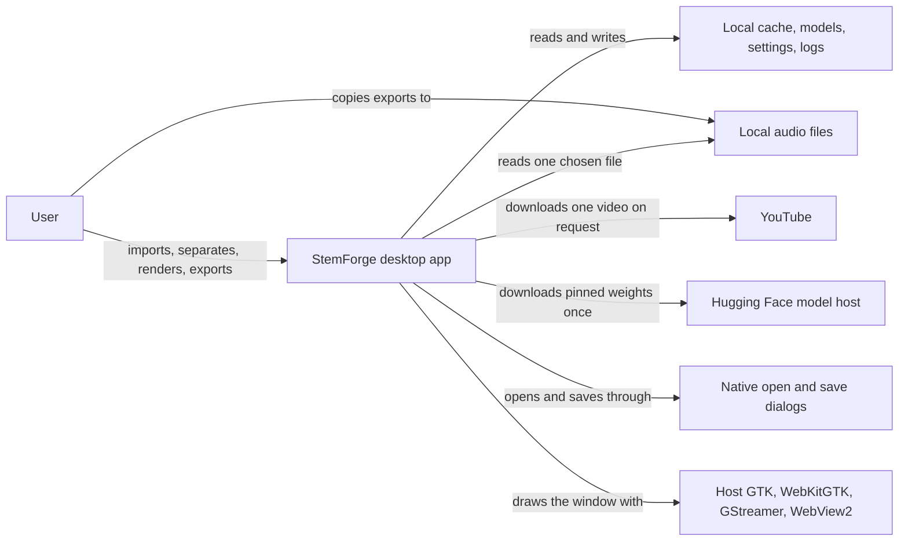
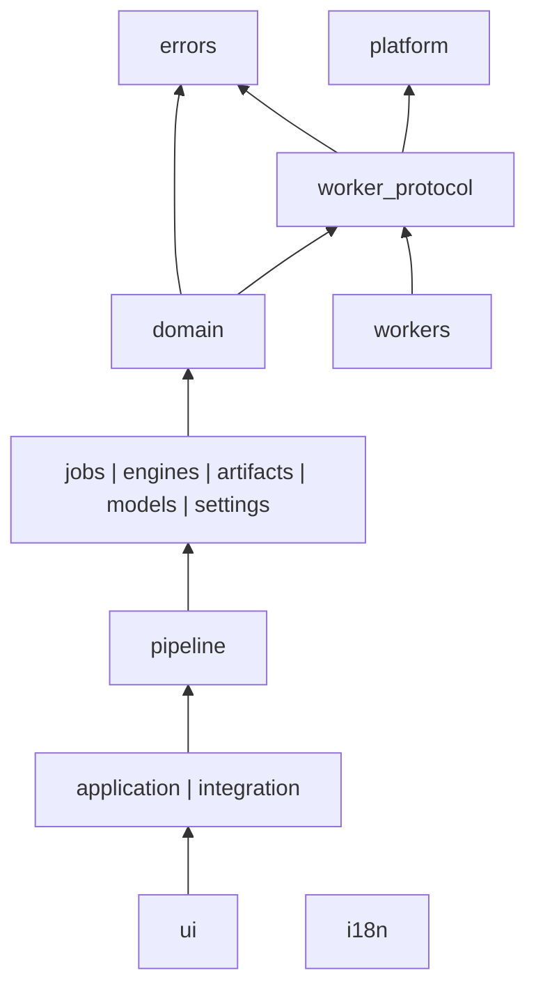
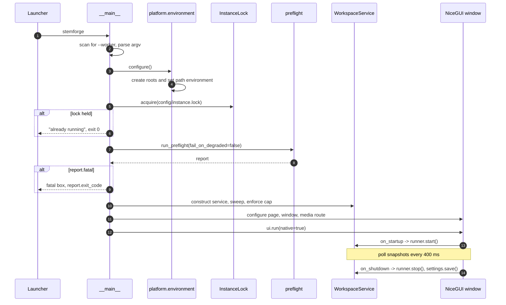
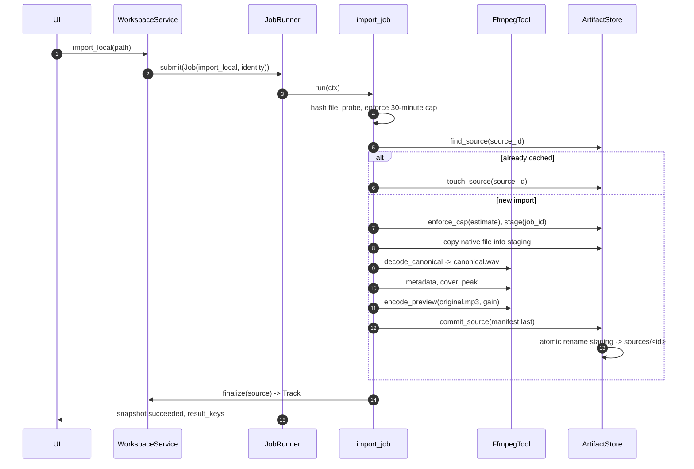
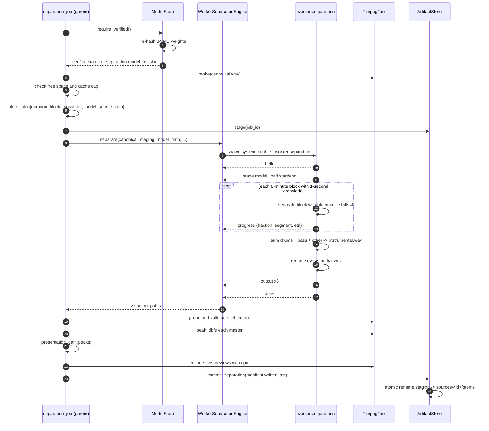
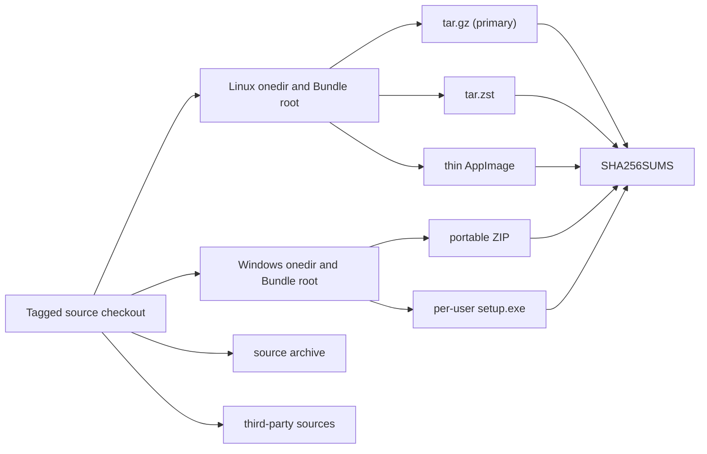

# StemForge architecture

StemForge is a desktop application that separates a Track into four Stems and an
Instrumental, shifts pitch without changing tempo, and exports the result through a
native save dialog. It runs entirely on the user's machine: a NiceGUI page in a pywebview
window, one serial Job queue, and a crash-isolated Demucs worker.

This document describes the system as it is. The [README](README.md) tells the product
story, [`GLOSSARY.md`](GLOSSARY.md) defines the vocabulary, and [`docs/adr/`](docs/adr/)
records why each decision was made. When this guide and an ADR disagree about intent, the
ADR wins; when either disagrees with the code, the code wins.

## Contents

1. [Introduction and Goals](#1-introduction-and-goals)
2. [Constraints](#2-constraints)
3. [Context and Scope](#3-context-and-scope)
4. [Solution Strategy](#4-solution-strategy)
5. [Building Block View](#5-building-block-view)
6. [Runtime View](#6-runtime-view)
7. [Deployment View](#7-deployment-view)
8. [Crosscutting Concepts](#8-crosscutting-concepts)
9. [Architecture Decisions](#9-architecture-decisions)
10. [Quality Requirements](#10-quality-requirements)
11. [Risks and Technical Debt](#11-risks-and-technical-debt)
12. [Glossary](#12-glossary)

## 1. Introduction and Goals

StemForge takes a local audio file or one public YouTube video, decodes it once into a
canonical WAV, and runs it through Demucs, Rubber Band, and FFmpeg without sending audio
anywhere. The window stays interactive while a Job runs, every Job is cancellable, and a
restart never destroys finished work.

Four quality goals explain most of the code:

| Goal | What it forces |
|---|---|
| Local-first and offline | No account, telemetry, or upload. The only network operations are the explicit model download and a YouTube import the user requests. |
| A responsive window during long Jobs | One background runner thread, immutable Job snapshots polled by the UI, and Separation in a separate worker process. |
| Reproducible per-platform packaging | Frozen onedir Bundles, pinned vendor binaries, pinned Python wheels, and a generated licence tree. |
| No data loss on cancel or crash | Staging directories plus one atomic promotion per Artifact set; recovery sweeps residue but never deletes committed work. |

## 2. Constraints

These constraints shape the code; they are not preferences.

| Constraint | Consequence in the code |
|---|---|
| GPL-3.0-only with Corresponding Source | [`LICENSE`](LICENSE), generated [`THIRD_PARTY_NOTICES.md`](THIRD_PARTY_NOTICES.md) and [`SOURCE_OFFER.md`](SOURCE_OFFER.md), and a `LICENSES/` tree in every Bundle. |
| Python 3.13 only | `requires-python = ">=3.13,<3.14"` in [`pyproject.toml`](pyproject.toml); the frozen CPython is the only interpreter shipped. |
| CPU-only torch | Torch is a direct dependency from the `pytorch-cpu` index, and both build scripts refuse a non-`+cpu` wheel. |
| Linux and Windows only, x86-64 with AVX2 | Preflight rejects other systems (exit 7); PyInstaller specs and packaging scripts exist only for these targets. |
| Host GTK 3, WebKitGTK 4.1, Soup 3, and GStreamer on Linux | The Bundle does not carry them; `run.sh` falls back to browser mode when the native stack is absent (ADR [0011](docs/adr/0011-the-linux-appimage-is-a-thin-host-dependent-wrapper.md)). |
| WebView2 and .NET Framework 4.8 on Windows | The Edge Chromium backend is asserted rather than allowing pywebview's legacy fallback; a missing runtime stops launch (exit 5). |
| No telemetry | The logger writes local files only; the diagnostics report is copy-only and never uploaded. |
| One public, non-age-gated YouTube video per import | The URL parser accepts one video id; playlists, channels, search pages, and cookies are rejected (ADR [0007](docs/adr/0007-youtube-import-is-pinned-and-cookie-free.md)). |
| Local Tracks capped at 30 minutes, YouTube at 15 | Import refuses longer audio after probing; Separation is planned in bounded blocks (ADR [0008](docs/adr/0008-separation-blocks-and-30-minute-cap.md)). |
| 8 GB RAM and 20 GB free disk recommended | Separation blocks hold peak memory near 2.7 GiB; preflight warns below 8 GiB RAM and 20 GiB disk, and flags 2 GiB disk as the hard floor. The default cache cap is 8 GiB. |

## 3. Context and Scope

### 3.1 System context

StemForge is a single-user desktop program, with no StemForge server, account service, or
cloud storage.



Everything inside the solid app box is StemForge: the NiceGUI page, the application
facade, the Job runner, the pipeline functions, the engine adapters, the artifact store,
and the separation worker. The host libraries, the bundled vendor binaries, the model
weights, and the user's filesystem are external.

### 3.2 External interfaces

| Interface | Direction | Role | Failure handling |
|---|---|---|---|
| FFmpeg and ffprobe | Out | Probe, decode canonical WAV, encode MP3 previews and exports, measure peaks. | Coded `media.*` errors; a missing vendor binary is `preflight.bundle_damaged` (exit 8). |
| Rubber Band | Out | Pitch shift the Track or each Stem with formants preserved. | `pitch.engine_missing` or `pitch.render_failed`; the Job leaves no partial output. |
| Deno and yt-dlp | Out | Extract and download one YouTube audio stream in-process. | Classified `import.youtube_*`, `import.network`, and extractor-drift errors. |
| Pinned `htdemucs` weights | In | The separation model, downloaded once from Hugging Face after consent. | `separation.model_missing` or `separation.model_download_failed`; SHA-256 is verified again before every Separation. |
| GTK 3, WebKitGTK 4.1, Soup 3 | In | Native window on Linux. | Missing window stack is fatal for native mode (exit 3), but `run.sh` retries in browser mode. |
| GStreamer | In | In-app Preview on Linux. | A missing element is a degraded mode (exit 4), announced in the UI. |
| WebView2 and .NET 4.8 | In | Native window on Windows. | Fatal (exit 5); the portable ZIP carries the offline bootstrapper. |
| Native open/save dialogs | In | Choose local audio and the Export destination. | A cancelled dialog is not an error; untrusted or malformed paths are coded selections. |
| Local filesystem | In and out | User source files and Export destinations. | Coded `import.file_unavailable`, `export.write_failed`, `storage.*`. |

### 3.3 What is outside the boundary

- The operating system's window stack, audio stack, and C++ runtime are host-provided;
  YouTube and Hugging Face are network services StemForge calls but does not control.
- The model weights are third-party data with no granted licence and are not part of the
  Bundle (ADR [0009](docs/adr/0009-demucs-weights-are-downloaded-not-bundled.md)).
- The user's original audio is never modified; Export writes a new file only.

## 4. Solution Strategy

Six decisions explain most of the code.

1. **Canonical audio at import.** Every Source is decoded once into stereo 44.1 kHz
   float32 WAV, and every stage reads that copy (ADR
   [0001](docs/adr/0001-canonical-audio-format.md)).
2. **A serial Job queue with one worker thread.** `JobRunner` owns a FIFO queue, runs at
   most one Job, and publishes immutable `JobSnapshot` values that the UI polls every
   400 ms (ADR [0003](docs/adr/0003-serial-jobs-one-worker.md)). Separation alone gets a
   Python worker process for crash isolation.
3. **Artifacts are manifests plus files, not database rows.** Each committed directory
   carries a schema-versioned manifest written last; `ArtifactStore` discovers state by
   scanning manifests and never infers it from a filename (ADR
   [0004](docs/adr/0004-artifact-manifests-not-database.md)).
4. **Staging plus one atomic promotion.** A Job writes only inside `staging/<job_id>/`,
   writes the manifest last, then promotes the whole directory with one rename. A
   failure, cancel, or crash leaves committed Artifacts untouched (ADR
   [0012](docs/adr/0012-recovery-discards-unfinished-work-never-finished-work.md)).
5. **An adapter at every external tool.** `MediaTool`, `PitchEngine`, `SeparationEngine`,
   and `YouTubeTool` are protocols with one production implementation each; pipeline
   functions depend on the protocol, so tests inject fakes.
6. **One application facade for the UI.** `WorkspaceService` is the only application
   object the UI may call; per-feature collaborators stay internal, and the import
   contracts enforce it (ADR
   [0013](docs/adr/0013-one-application-facade-per-feature-collaborators.md)).

## 5. Building Block View

### 5.1 Layering and the import contracts

[`pyproject.toml`](pyproject.toml) declares one `layers` contract and three named
`forbidden` contracts. The layer order, from highest to lowest, is:

```text
ui
application | integration
pipeline
jobs | engines | artifacts | models | settings
domain | workers
worker_protocol
platform | errors | i18n
```

A layer may import lower layers, not higher ones. Siblings on one line are independent:
`application` does not import `integration`, `jobs` does not import `engines`,
`engines` does not import `jobs`, and `workers` does not import `domain`. The three
forbidden contracts add the named prohibitions:

- **UI never imports engines, workers, pipeline, jobs, or platform.** The UI may import
  `application`, `integration`, `domain`, and `errors`. Indirect imports are allowed so
  the facade can use the pipeline.
- **UI talks to the application facade only.** The UI may not import
  `application.service`, `application.state`, `application.views`,
  `application.renders`, `application.identity`, or
  `application.collaborators`.
- **Workers stay below the app.** A worker may not import `application`, `pipeline`,
  `engines`, `jobs`, `artifacts`, `domain`, `models`, `settings`, `integration`, or
  `ui`.



`platform`, `errors`, and `i18n` are independent base modules; none imports another.
`i18n` is stdlib-only, so every higher layer and `__main__` can resolve catalog copy;
the platform layer keeps its no-StemForge-import rule, and the pre-window fatal path
passes translated chrome in from the caller rather than pulling it up from `platform`.
`workers` sits beside `domain` because both are foundation code: the separation worker needs
`worker_protocol`, `platform`, and `errors`, but must not reach the server's pipeline or
application layers. Keeping it beside `domain` rather than under it makes that prohibition
explicit. `worker_protocol` is below both because the parent engine adapter and the worker
parse or format the same JSONL lines and exit codes; it is stdlib-only, so neither side
needs the other to agree on the wire format.

### 5.2 Packages and modules by layer

Every top-level package and every root module that occupies a layer in the import
contract.

| Unit | Responsibility | Key modules | Allowed dependencies |
|---|---|---|---|
| `ui` (package) | The NiceGUI page, theme tokens, formatting helpers, the error-code-to-catalog mapping, failure view, and feature cards. It owns no copy. | `page.py`, `theme.py`, `formatting.py`, `failure.py`, `toast.py`, `components/` | `application`, `integration`, `domain`, `errors` |
| `application` (package) | The UI's one facade, shared Workspace state, Job ledger, and per-feature collaborators. | `service.py` (`WorkspaceService`), `state.py` (`WorkspaceState`, `JobLedger`), `views.py`, `collaborators/` | `pipeline`, `jobs`, `engines`, `artifacts`, `models`, `settings`, `domain`, `platform`, `errors` |
| `integration` (package) | The OS edge: native dialogs, the media route, window configuration, path opener, diagnostics. | `dialogs.py`, `media.py`, `window.py`, `shell.py`, `diagnostics.py`, `assets.py` | `artifacts`, `models`, `settings`, `pipeline.export_names`, `platform`, `errors` |
| `pipeline` (package) | The Job bodies and pure helpers: import, YouTube import, Separation, Pitch Render, Export, Save original, model install. | `import_job.py`, `youtube_job.py`, `separation_job.py`, `pitch_job.py`, `export_job.py`, `export_batch_job.py`, `save_original_job.py`, `export_names.py`, `model_job.py`, `gain.py`, `source_manifest.py` | `jobs`, `engines`, `artifacts`, `models`, `settings`, `domain`, `worker_protocol`, `errors` |
| `jobs` (package) | Job values, the runner thread, immutable snapshots, cancellation. | `job.py`, `runner.py`, `models.py` | `domain`, `platform`, `errors` |
| `engines` (package) | Adapters for FFmpeg/ffprobe, Rubber Band, the Separation worker, and yt-dlp. | `media.py`, `pitch.py`, `separation.py`, `youtube.py` | `domain`, `worker_protocol`, `platform`, `errors` |
| `artifacts.py` (module) | The cache layout, manifest parsing, staging, promotion, lookup, and LRU eviction. | `ArtifactStore` | `platform`, `errors` |
| `models` (package) | The pinned model record and the durable weights store. | `spec.py`, `store.py`, `models.lock.json` | `domain`, `platform`, `errors` |
| `settings.py` (module) | The one persisted JSON document: recent files, cache cap, consents, export directory, Interface language. | `SettingsStore` | `domain`, `platform`, `errors`, `i18n` |
| `domain` (package) | Immutable domain values and pure aggregates: Source, Track, Workspace, roles, cancellation. | `models.py`, `workspace.py`, `roles.py`, `cancellation.py` | `errors` |
| `workers` (package) | The executable worker entry point; the only place torch and Demucs are imported. | `__init__.py` (`dispatch`), `separation.py` | `worker_protocol`, `platform`, `errors` |
| `worker_protocol.py` (module) | The JSONL event names, parser, exit codes, and block arithmetic shared across the process boundary. | `parse_event`, `format_event` | Standard library only |
| `platform` (package) | Paths, environment setup, preflight, the instance lock, resource roots, vendor binaries, process helpers, storage constants. | `paths.py`, `environment.py`, `preflight.py`, `instance.py`, `resources.py`, `binaries.py`, `process.py`, `storage.py` | Standard library and `platformdirs` only; no `stemforge` imports. |
| `errors.py` (module) | The one exception type, the cancellation subclass, and the stable code taxonomy. | `StemForgeError`, `JobCancelled`, `ALL_CODES` | Standard library only |
| `i18n` (package) | Per-locale JSON catalogs, message lookup with English fallback, plural forms, and Interface-language resolution. | `__init__.py`, `catalogs/en.json`, `catalogs/ro.json` | Standard library only; no other `stemforge` import. |

`assets/` is package data (icons and images), not importable code. Other root modules sit
outside the layer contract:

| Module | Responsibility |
|---|---|
| `__main__.py` | CLI parsing, launch order, headless modes, worker dispatch, fatal boxes. |
| `smoke.py` | `--self-test`, `--smoke-test`, and `--smoke-separation`. |
| `logging_setup.py` | App log, per-Job logs, and Job-log retention. |

### 5.3 Key types and where they live

| Type | Location | Contract |
|---|---|---|
| `WorkspaceService` | `application/service.py` | The only API the UI may call. It wires the stores, runner, engines, settings, and collaborators, and keeps the cross-feature operations `remove_track` and `open_recent`. |
| `JobRunner` | `jobs/runner.py` | Owns the FIFO queue, the single active Job, dedupe by `Job.identity`, cancellation, and immutable `JobSnapshot` publication. |
| `Job`, `JobContext` | `jobs/job.py` | A `Job` is a kind, a non-empty identity tuple, a title, and a callable. `JobContext` is the pipeline-facing seam: progress, cancel token, and a Job-scoped logger. |
| `ArtifactStore` | `artifacts.py` | The only writer of artifact files. It owns `sources/`, `renders/`, `staging/`, manifests, promotion, lookup, and LRU eviction. |
| `Workspace` | `domain/workspace.py` | The ordered, session-scoped set of Tracks; one Track per Source; snapshots are immutable. It is pure: the service owns locking. |
| `Track`, `Source` | `domain/models.py` | Immutable identity and on-disk locations. `Track` is the session handle; `Source` is the imported audio record. |
| `SettingsStore` | `settings.py` | Reads and writes one JSON document atomically; recent files, cache cap, export directory, Interface language, model consent, and YouTube consent. |
| `AppPaths` | `platform/paths.py` | The six writable roots: `data`, `cache`, `logs`, `models`, `config`, `webview`; construction never touches disk. |
| `PreflightReport` | `platform/preflight.py` | The six startup checks, exit-code mapping, degraded/fatal state, and JSON/human rendering. |
| `worker_protocol` | `worker_protocol.py` | Event names, `parse_event`/`format_event`, exit codes, output-name validation, and `block_count`. |
| `Translator`, `Locale` | `i18n/__init__.py` | Catalog lookup with English fallback and plural selection; each locale's autonym and plural-rule name. |

The application facade is also the composition root: it constructs `WorkspaceState`,
`JobLedger`, `ArtifactStore`, `ModelStore`, and the nine collaborators. A collaborator
receives explicit dependencies and never holds the facade.

### 5.4 Where changes belong

| Change | Files | Contract to preserve |
|---|---|---|
| Add a Job kind | `domain/models.py` (`JobKind`), a new or extended `pipeline/` function, the owning `application/collaborators/` module, a stage/detail code in `domain/progress.py` plus English copy, and `ui/page.py` if it needs a new failure surface. | A Job must return a mapping of string result keys or `None`; its `identity` must be stable while active; it must honour `ctx.cancel` at every checkpoint before the manifest write. |
| Add an engine adapter | A protocol and implementation under `engines/`, a field in `application.ServiceEngines`, wiring in `__main__._run_ui`, and a fake in tests. | The adapter must not import `jobs` or `pipeline`; take `CancelToken` from `domain.cancellation`; raise `StemForgeError` with an existing code; leave partials cleaned up. |
| Add an export format | `engines/media.py` (`ExportFormat`, codec/format maps, suffix), `pipeline/export_names.py`, `integration/dialogs.py` filters, and the Export card copy. | Export applies the set's recorded gain once, writes through a destination `.partial`, verifies tags before promotion, and never overwrites the source or an existing file. |
| Add a UI card | `ui/components/<name>.py`, composition in `ui/page.py`, matching copy keys in `i18n/catalogs/en.json` and `ro.json`, formatting in `ui/formatting.py`, and calls on `WorkspaceService`. | The UI may import only `application`, `integration`, `domain`, and `errors`; it must render from snapshots and never mutate a store directly. |
| Change the cache policy | `platform/storage.py` (`DEFAULT_CACHE_CAP_BYTES`), `artifacts.py` (`plan_evictions`, `enforce_cap`, `sweep_stale`), `settings.py` (`cache_cap_bytes`), and Settings copy. | Eviction is whole-set, oldest-first, and never touches a live Source or its renders. Only Remove, LRU under the cap, and Clear cache delete cached audio. |
| Add a platform check | `platform/preflight.py` (`CHECK_*`, `CheckResult`, `run_preflight`, `_exit_code_for`), `platform/binaries.py` or `resources.py` if it tests a file, `run.sh` fallback if it is non-fatal, and packaging notes. | Resource warnings never block launch; a fatal check maps to a stable exit code and a fatal message; a degraded capability is announced. |

## 6. Runtime View

### 6.1 Normal launch

`__main__.main` parses arguments, dispatches an internal worker before any app setup,
then resolves `AppPaths` and creates the roots. The single-instance lock is taken before
the preflight report, so a second launch never sweeps or touches artifacts.



The heavy stack is imported late: `__main__` imports only argparse, logging,
multiprocessing, `platform.preflight`, and type-checking names; `_run_ui` imports NiceGUI,
the application facade, the engine adapters, integration modules, logging, settings, and
`ui.page`; `workers/separation.py` imports torch and Demucs inside `run()`. The frozen
contract adds `multiprocessing.freeze_support()` first in the main guard, so the
re-invoked worker does not re-run the app.

### 6.2 Headless modes

Every mode returns a process exit code and never opens the workspace window.

| Mode | What it does | Notes |
|---|---|---|
| `--preflight` | Runs the six checks and prints or writes the report. | `--json`, `--quiet`, and `--report PATH` apply. Exit codes: 0 ok, 3 window, 4 Preview degraded, 5 WebView2, 6 storage, 7 platform, 8 Bundle. |
| `--import PATH` | Runs one local import Job synchronously on a started runner, waits for idle, then prints a one-line result. | Uses the same `WorkspaceService` and pipeline as the UI; no NiceGUI import. |
| `--install-model` | Runs the model install Job. | Requires `--accept-model-licence` when stdin is not a terminal; an accepted licence or an installed model skips the prompt. |
| `--diagnostics` | Prints the copy-only diagnostics report. | `--report PATH` selects the diagnostics writer when no other mode is present. |
| `--self-test` | Checks the runtime, data roots, Bundle roots, assets, vendor binaries, and CPU torch build. | Emits a JSON report; `stemforge --self-test` is part of `scripts/check.sh`. |
| `--smoke-test` | Runs the self-test, then boots the local server headlessly and polls `/` for HTTP 200. | Used by the frozen-bundle CI gate. |
| `--smoke-separation` | Runs a one-second synthetic WAV through the real worker with the installed weights. | Never downloads; also asserts the worker's RSS ceiling. |
| `--worker separation` | Internal dispatch to `workers.separation.run`. | Scanned before argparse, environment setup, and the instance lock, so a second process can still run the bundled worker. |

The model-install Job precedes Separation: it verifies installed weights first (an
idempotent, offline success), otherwise requires current consent, resumes the `.partial`
with `Range`, hashes while writing, and promotes only on a size and SHA-256 match. The
page latches one Separation request so a successful install can resubmit it once.

### 6.3 Import

A local import is one Job with four stage labels: Probing, Decoding, Reading metadata,
and Saving. The original file is read, never moved or modified.



Details that matter to the rest of the system:

- The Source id is a BLAKE2b digest of the bytes, so a re-import reuses the cache and
  refreshes its LRU marker.
- The canonical WAV is `pcm_f32le`, 44 100 Hz, two channels. Mono is duplicated to
  dual-mono, multichannel is downmixed (`downmixed: true`), and the native file is kept so
  recovery can repair a missing canonical or preview.
- Preview is MP3 192 kbit/s with the presentation gain; the float32 master is never
  attenuated. `source.json` is written last and promoted with one rename, and the
  free-space estimate adds a 1.2 Job headroom plus a 1 GiB floor; the gate requires
  `max(1 GiB, estimate × 1.5)` on disk.

A YouTube import is the same Job shape with stage labels Checking video, Downloading
audio, Decoding audio, and Finishing. The URL parser accepts one video id; yt-dlp runs
in-process; two five-second politeness waits pace the request. A cached Source is reused,
and a surviving native file repairs the canonical and preview locally without the network.

### 6.4 Separation

Separation crosses a process boundary. The parent pipeline verifies the model, plans the
blocks, spawns the worker, validates every output, measures one gain, encodes previews,
writes the manifest, and promotes the set. The worker imports torch and Demucs and
writes five WAVs.



The stdout protocol is JSONL, one object per line, each carrying `"v": 1`; stderr is
human log only. The event types are `hello`, `stage`, `progress`, `output`, `done`, and
`error`; unknown event names are ignored so a newer worker can add events without
breaking an older parent. Separate reader threads pump stdout and stderr so a large
Demucs log cannot block progress parsing.

The worker's argv carries the model name, path, revision, device (`cpu`), canonical
input, output directory, threads, expected duration, and the block plan. Block mode uses
`shifts=0` and Demucs' own `overlap=0.25`; `htdemucs` still sees its internal 7.8-second
segments, and the only new edge is the one-second linear crossfade at each boundary.
Exit codes are part of the contract: `0` success, `2` handled failure with an `error`
event, `3` model unavailable, `4` invalid input. A hard timeout reports
`separation.engine_error` with `reason=timeout`.

Progress is monotonic: the worker owns 2%–88%, and validation, gain, and previews share
the rest. The UI shows the stage label and, for a YouTube import, the byte detail.

### 6.5 Pitch Render

A Render is an explicit action, not an automatic consequence of Separation. It reads
either the original Track's canonical WAV or all four committed Stems.

- `scope=original` shifts the canonical master into one output.
- `scope=stems` shifts each of vocals, drums, bass, and other, then sums drums + bass +
  other in float32 to produce a shifted Instrumental.
- Semitones are integers in `-12..+12`, excluding zero. Rubber Band runs as
  `rubberband -3 -F -p <n> --ignore-clipping`, which selects R3, preserves formants, and
  keeps the relative level of the Stems. The engine validates the output before renaming
  its partial into place.
- A Render set's identity (`render_key`) hashes the source id, the scope, the semitone
  count, every input file hash, and the engine version/preset. A master Render can never
  answer a stems request, and a changed input produces a new set.
- The set records one presentation gain, encodes one preview per output, writes its
  manifest last, and reuses an existing set without staging another.

Each Render set is an independent Artifact. Rendering +3 does not modify the +1 set, and
a later Separation does not invalidate earlier Render sets; the UI marks a stems Render
based on an earlier Separation as stale rather than deleting it.

### 6.6 Export

Export copies one committed Artifact to a destination the user chooses. It never
normalises, never invents a gain, and never writes over the source audio or an existing
file.

1. `WorkspaceService.export_targets` enumerates the master, the Separation outputs, and
   every Render set, newest first. Each target carries its role, gain, semitones, scope,
   and suggested Windows-safe base name.
2. The native save dialog returns an absolute path; `NativeSaveDialog` repairs a known
   audio extension to the selected format but never reinterprets a wrong extension as a
   format request.
3. The Job re-resolves the target against the current manifests with hash verification,
   probes its duration, checks free space against the WAV-24 worst case, and requires the
   destination directory to exist and be writable.
4. FFmpeg encodes into `staging/<job_id>/export.<ext>` as WAV 24, FLAC 24, or MP3 320.
   Tags and cover art come from the Source record; WAV carries only the INFO subset that
   FFmpeg persists.
5. The encoded file is copied to `<final-name>.partial` at the destination, `fsync`ed,
   and renamed with collision handling. Every handled failure or cancel removes the
   partial; a hard crash is the one documented exception.

The result carries the path, format, size, SHA-256, metadata, cover, and the manifest
that was logged. The UI shows success or the coded failure; it never reads the cache
store directly.

#### Batch Export

A batch exports every output of one Artifact set — the version tab the Outputs card shows,
never the Original — in one format and to one existing folder. It is **one `EXPORT_BATCH`
Job**, not N Export Jobs (ADR 0015), so the Job bar shows aggregate progress, Cancel stops
the whole batch, and the runner records one identity and one history entry.

1. `WorkspaceService.export_batch_targets` plans the active version in card order: Vocals,
   Instrumental, Drums, Bass, Other. A two-output Separation exports two files; a stems
   Render exports five; the master and other versions are never mixed in.
2. `NativeFolderDialog` returns a trusted absolute existing directory. The sheet shows it
   with a "Choose folder…" action and remembers it as the preferred export directory; the
   Job still never creates a directory.
3. The batch probes each planned target once, sums their durations into a single WAV-24
   estimate, and checks free space before writing the first file. Each item keeps its own
   free-space check as a backstop.
4. The wrapper runs `run_export_job` per item, mapping item progress into one aggregate
   fraction. The existing Windows-safe base name and ` (2)` collision sequence apply flat
   in the chosen folder; nothing is overwritten.
5. Every item outcome is written to a lock-guarded `ExportService` record as it finishes.
   The runner's `result_keys` are only recorded on success, so they cannot carry the list.
6. An item-level failure is recorded and the rest continue; after the loop the batch fails
   with the first failure's code and a count context. A destination-level failure (disk
   full or write failure) stops the batch and marks the rest not exported. Cancel removes
   the current partial, keeps written files, and marks the rest not exported.
7. The results bar lists every item as written, failed with its coded copy, or not
   exported. Failed-only Retry and not-written-only "Export remaining N" resubmit a subset
   to the same folder and format, so completing a failed or cancelled batch never creates
   duplicate ` (2)` files.

#### Save original

Save original is a sibling of Export, not an Export format (ADR 0017). It copies a local
Source's Native file — the untouched file the Import cached — byte for byte to a
user-chosen destination. It never probes, decodes, encodes, rewrites tags, applies gain,
resamples, or downmixes.

1. The single-mode Export sheet shows the Imported file block only on the Original target
   of a local Source. A YouTube Source is refused because its native file is the
   downloaded container, not a file the user supplied.
2. `WorkspaceService.imported_file` reads the manifest's `native` entry for the block's
   extension and size without hashing or probing. `submit_save_original` runs the
   local-only guard before it queues anything.
3. The Job re-reads the manifest, verifies the recorded size, checks free space against
   the Native file's own size, and copies to a destination `.partial` while hashing. The
   recorded SHA-256 must match or the partial is removed and the Job fails
   `export.original_unavailable`/`changed`.
4. The partial is `fsync`ed and renamed with the same collision handling as Export. A
   missing manifest, native role, or file is `.../missing`; cancellation removes the
   partial. The result carries the path, size, and SHA-256.
5. Retry reuses the same destination; "Choose another location…" reopens the native save
   dialog. The batch sheet never includes Save original.

### 6.7 Cancellation and shutdown

`CancelToken` wraps a `threading.Event` and raises `JobCancelled` at checkpoints. It
lives in `domain.cancellation` because engine adapters take it and `engines` must not
import `jobs`.

- The runner cancels a queued Job by dropping it and marking it cancelled. A running Job
  has its token set; the Job observes it at the next checkpoint.
- Engine adapters check the token around every external call. FFmpeg and Rubber Band
  processes are terminated, and their partial outputs are removed.
- The Separation engine closes the child's stdin, which the worker treats as a stop
  request, then terminates the process tree after a two-second grace period.
- On shutdown, `runner.stop()` cancels the active Job and queued Jobs, joins the thread
  with a five-second timeout, and logs if it is still alive. Settings are saved
  afterwards; a settings write failure is logged, not raised.
- Every pipeline function discards `staging/<job_id>/` on an exception, including
  cancellation, before the exception leaves. Export and Save original also remove the
  destination partial.
- The window has no close veto: closing it ends the app immediately, and the runner stop
  is the last chance to clean the active Job's staging.

### 6.8 Recovery

Startup recovery is a sweep, not a resume.

| On restart | Behaviour |
|---|---|
| `staging/<job_id>/` | Deleted. A Job that was mid-write is simply re-run. |
| `tmp/` children | Deleted. |
| `*.partial*` under `sources/` and `renders/` | Deleted. Partials are never playable or exported. |
| `.*.old-*` replacement residue | Deleted. A crashed replacement leaves the aside directory behind. |
| Committed Sources, Separations, and Renders | Kept. Manifests are the source of truth; a set with an invalid manifest is treated as absent, not deleted. |
| Settings, recent list, model weights | Kept. The model download's own `.partial` is kept and resumed, not swept. |
| Open Workspace | Empty. The Workspace is session-scoped; the cache is not. |
| Job history | Empty. The runner's in-memory history is gone. |
| Job logs | Pruned to the newest 20 and seven days by the runner's retention sweep. |

If the sweep deleted anything, the page shows a recovery banner; otherwise the launch is
silent. A crash cannot leave a stale instance lock because the OS drops the advisory lock
when the process exits. The cache is never treated as garbage just because no Track
references it.

## 7. Deployment View

### 7.1 Bundle shapes

Two onedir Bundle trees produce five user-facing distribution files.

| Asset | Platform | Shape | What it carries |
|---|---|---|---|
| `StemForge-<ver>-linux-x86_64.tar.gz` | Linux | Primary portable Bundle | Frozen launcher, `_internal/`, `vendor/`, `LICENSES/`, licence and notice files, `run.sh`. |
| `StemForge-<ver>-linux-x86_64.tar.zst` | Linux | Same tree, zstd-compressed | Identical payload; a smaller download for hosts with `zstd`. |
| `StemForge-<ver>-linux-x86_64.AppImage` | Linux | Thin wrapper | The same onedir tree at `usr/lib/stemforge`, `AppRun`, a desktop entry, and a symlink; no GTK, WebKitGTK, or GStreamer. |
| `StemForge-<ver>-win64-portable.zip` | Windows | Portable Bundle | Frozen launcher, `_internal/`, `vendor/`, licence tree, `README.txt`, and the WebView2 bootstrapper. |
| `StemForge-<ver>-win64-setup.exe` | Windows | Per-user installer (Inno Setup) | The same tree plus the bootstrapper as a `dontcopy` file; per-user install, no administrator rights. |

Both trees share the same layout rule (ADR
[0010](docs/adr/0010-vendored-binaries-live-outside-the-frozen-payload.md)): `vendor/`
and the licence tree sit beside `_internal/`, never inside it. The Windows tree is the
same minus `run.sh`, with `StemForge.exe` and `README.txt`.

```text
StemForge-<ver>-linux-x86_64/
├── StemForge
├── _internal/                CPython, torch, Demucs, NiceGUI, yt-dlp, assets
├── vendor/{ffmpeg,deno,rubberband}/
├── LICENSES/                 third-party licence texts
└── LICENSE, THIRD_PARTY_NOTICES.md, SOURCE_OFFER.md, run.sh, README.md
```

### 7.2 Build and release flow



Linux also verifies the payload before compressing it: `verify_bundle.py` walks the
Bundle root, checks the vendor lock, the licence tree, the torch trim, and the size
budgets. The tar archives are deterministic (`SOURCE_DATE_EPOCH`, sorted members,
numeric owner). The AppImage uses a pinned `appimagetool` and type-2 runtime from
[`packaging/linux/appimage.lock.json`](packaging/linux/appimage.lock.json).

### 7.3 Vendor binaries and their licences

The vendor tree is pinned by [`packaging/vendor.lock.json`](packaging/vendor.lock.json):
per target, it records the archive URL, size, SHA-256, the files to extract, and each
extracted file's hash. `scripts/vendor-fetch.sh` (and the PowerShell equivalent) verifies
before use. Preflight additionally runs each tool and compares its reported version with
the lock.

| Tool | Version | Licence | Notes |
|---|---|---|---|
| FFmpeg and ffprobe | `n9.0.2-57-gd838f9f9ae` | GPL-3.0-or-later | Static GPL build from BtbN; the build configuration is recorded in `LICENSES/ffmpeg/BUILDINFO.txt`. |
| Rubber Band | 4.0.0 | GPL-2.0-or-later | CLI built from the pinned tag. |
| libsndfile | 1.2.2 | LGPL-2.1-or-later | Co-located with Rubber Band; the Linux loader needs `LD_LIBRARY_PATH` or the `$ORIGIN` rpath. |
| Deno | 2.9.8 | MIT | JavaScript runtime for yt-dlp's EJS support. |

Each component keeps its own licence and notice. `THIRD_PARTY_NOTICES.md` lists every
Python package, native component, and vendor archive with versions, licences, and
sources; `LICENSES/` holds the full texts. PyGObject is a Python wheel inside `_internal/`
rather than a vendor binary, and its notice is generated with the Python packages.

### 7.4 Model weights

`htdemucs` is a separate download, not part of any Bundle (ADR
[0009](docs/adr/0009-demucs-weights-are-downloaded-not-bundled.md)). The pin lives in
`src/stemforge/models/models.lock.json`: repository, revision, filename, size, SHA-256,
download URL, source URL, licence, and notice version.

The durable layout under the data root is `<data>/models/htdemucs/<filename>`, its
`<filename>.partial`, and the marker `<data>/models/installed/htdemucs.json`. The install
Job appends to the partial with a `Range: bytes=<size>-` request when a previous attempt
left data, hashes while streaming, requires the pinned size and SHA-256, and promotes
with one `os.replace` followed by the marker. A short partial stays for the next attempt;
a complete-but-wrong file is discarded. Before every Separation the store re-hashes the
weights; a mismatch deletes the weights and marker so the UI can offer a fresh download.

### 7.5 Host dependencies and fallback

On Linux the Bundle does not carry GTK 3, WebKitGTK 4.1, Soup 3, GStreamer, or the C++
runtime. `run.sh` runs `--preflight --quiet` first:

- exit 3 (native window unavailable) or exit 4 (Preview unavailable) starts browser mode
  and prints the URL; every other non-zero exit stops the launch, so a damaged Bundle is
  not hidden behind a fallback; `STEMFORGE_BROWSER=1` skips the native probe entirely.

Browser mode serves the same page on `http://127.0.0.1:8080`. The window configuration
sets `WEBKIT_DISABLE_DMABUF_RENDERER=1` by default on Linux to keep WebKitGTK off
the DMABUF path that paints a blank view on NVIDIA/X11 (WebKitGTK 2.52+); an
explicit user value wins. See
[ADR-0015](docs/adr/0015-linux-disables-the-webkit-dmabuf-renderer.md) and
[the verification record](docs/verification/linux-white-window.md).

### 7.6 Writable data

All runtime writes go through `AppPaths`. The six roots are created with mode `0700`;
construction never touches disk.

| Root | Linux default | Windows default | Contents |
|---|---|---|---|
| `data` | `~/.local/share/stemforge` | `%LOCALAPPDATA%\StemForge` | Model store, webview storage. |
| `cache` | `~/.cache/stemforge` | `%LOCALAPPDATA%\StemForge\Cache` | Sources, renders, staging, tmp, yt-dlp cache, eviction journal. |
| `logs` | `~/.local/state/stemforge/log` | `%LOCALAPPDATA%\StemForge\Logs` | App log and per-Job logs. |
| `models` | `<data>/models` | `<data>\models` | Downloaded weights and the install marker. |
| `config` | `~/.config/stemforge` | `%LOCALAPPDATA%\StemForge` | `settings.json`, `instance.lock`, NiceGUI storage secret. |
| `webview` | `<data>/webview` | `<data>\webview` | pywebview's persistent storage. |

`STEMFORGE_HOME` replaces every root with one portable layout:
`data/`, `config/`, `cache/`, `logs/`, with models at `data/models` and webview storage
at `data/webview`. It is intended for portable installs, testing, and CI.

### 7.7 Release assets

A release is the exact asset set, not a superset: the three Linux files
(`tar.gz`, `tar.zst`, `AppImage`), the two Windows files (`portable.zip`, `setup.exe`),
`StemForge-<ver>-src.tar.gz`, `StemForge-<ver>-third-party-sources.tar.zst`, and
`SHA256SUMS`. `scripts/verify-release.sh` checks the archives, the Bundle-root licence
tree, the vendor lock, the exact names, the size budgets, and the sums. `SHA256SUMS` is
written last and covers every other asset.

The source archive is the tagged tree; the third-party archive contains the vendor and
copyleft package sources. Every Bundle also ships `LICENSE`, `THIRD_PARTY_NOTICES.md`,
`SOURCE_OFFER.md`, and `LICENSES/`; the generated tree is checked for drift by
`scripts/generate_notices.py --check`.

## 8. Crosscutting Concepts

### 8.1 Concurrency

One `JobRunner` daemon thread owns every Job: a FIFO queue, at most one active Job, a
dedupe map keyed by `Job.identity`, and one condition variable around every state change.
Readers receive immutable `JobSnapshot` values and never hold the runner's lock while
rendering.

The UI polls `WorkspaceService.jobs()` and the active snapshot every 400 ms; there is no
event bus. The separation worker is the only second process. FFmpeg, Rubber Band, and
yt-dlp are adapters on the runner thread and never block the NiceGUI event loop.

`WorkspaceState` owns a re-entrant lock for the Workspace; `JobLedger` uses it to record
which Track or Source owns each Job, so Remove can cancel the right work before deleting
cache. The artifact store has its own lock, and the two are never nested.

### 8.2 Errors and copy

`StemForgeError` is the only exception type the UI sees: a stable dotted `code`, a
log-only `message`, `retryable`, `detail`, and structured `context`. `JobCancelled` is the
cancellation subclass. The taxonomy groups codes by subsystem: `import.*`, `decode.*`,
`separation.*`, `pitch.*`, `media.*`, `export.*`, `logging.*`, `storage.*`, `internal.*`,
`preflight.*`, `playback.*`, and `licensing.*`.

The English catalog in `stemforge/i18n/catalogs/en.json` is the only source of
user-visible copy; `ro.json` mirrors every key and English is the per-key fallback.
Page and component copy, error headlines and actions, Job stage and detail codes,
preflight dialog chrome, consent notices, and About summaries resolve at render time
through flat semantic message IDs. `ui/formatting.py` maps `(code, reason)` to catalog
keys and composes the dynamic sentences (duration, folder, required and free space,
path); it owns no prose. An unknown code from a newer worker falls back to
`internal.unexpected`. A degraded capability is announced, never silent. Application
and pipeline views carry stable role, kind, and semitone display keys plus context;
`domain/display.py` owns those codes and the UI resolves them at render time.

Job snapshots keep the English stage and detail strings alongside their codes for logs,
the diagnostics report, and the headless CLI; the UI prefers the code and uses the
English string only when a code is unknown. Exported filenames still use the English
role labels in `pipeline/export_names.py`, so translating the interface never changes a
filename. The Interface language is a `system`/`en`/`ro` preference resolved at startup;
selecting one persists it, swaps the process translator, aligns NiceGUI's framework
language and the page's `lang` attribute, and reloads the page while the Workspace and
Jobs live in the application service.

The English-only boundary is explicit: logs, the diagnostics report body, preflight
report messages, CLI output (including `--preflight` stdout while the native dialog stays
translated), internal identifiers, exported filenames and audio tags, native file-dialog
filter descriptions, and licence documents. Preflight/fatal dialog chrome, consent notices, About summaries,
Job labels, and page copy are translated. `tests/unit/test_copy_policy.py` fails on an
inline literal at a page, component, or preflight-chrome sink, on a catalog key missing
from either locale, on a formatting copy constant, and on a glossary synonym, cedilla,
or term-table violation. `docs/i18n/ro/terms.md` records the approved Romanian
renderings, and `CODING_STANDARDS.md` records the judgement calls around the rule.

Retryability is a property of the failure, not a guess by the UI: a download, a missing
file, or a cache-full condition is retryable; malformed input or a licence refusal is not.
A failed Job keeps its code, detail, context, and Job-log path for diagnostics.

### 8.3 Logging and diagnostics

The app logger `stemforge` writes `<logs>/stemforge.log` with a 2 MiB cap and three
backups; `STEMFORGE_LOG_LEVEL` sets the level. Each Job gets a capped 10 MiB log at
`logs/jobs/<UTC stamp>-<job_id>.log`, created on start, closed on finish, and pruned to
the newest 20 and seven days on runner start. Uvicorn loggers stay at warning.

The diagnostics report is copy-only: version, Bundle kind, OS, Python, CPU, cores,
threads, RAM, free disk, the preflight summary, every writable path, cache usage and cap,
source and render counts, seven-day evictions, settings, the resolved Interface language
and its `system`/`override` source, model state, the ten newest Jobs, the last 200 app-log
lines, and the last 100 lines of one Job log. The report body stays English. It never zips,
uploads, or writes itself; `--report PATH` is the only writer.

### 8.4 Settings and state

`SettingsStore` owns `<config>/settings.json`. Writes go through a temporary file,
`fsync`, and `os.replace`, serialised by one process lock; a corrupt document is moved
aside as `settings.corrupt-<stamp>.json` and defaults are recreated. The schema is
versioned.

The document holds the ten-entry MRU recent list, the last export directory, the
first-run flag, the Interface language preference, the cache cap, the model consent (with
its notice version), the YouTube toggle, and the YouTube notice acknowledgement. A consent
older than the bundled notice version is treated as absent. An unknown or wrong-typed
language value falls back to `system` without moving the document aside.

Settings are separate from the Workspace: the Workspace holds Tracks for this session
only, while settings, cache, and model store survive restarts.

### 8.5 Cache and artifacts

The cache is a rebuildable store of imported Sources and derived Artifacts. It is not a
project library: the user can clear it, and the OS may evict it. Its layout is:

```text
<cache>/
├── sources/<source_id>/
│   ├── native.<ext>            original bytes, untouched
│   ├── canonical.wav           stereo 44.1 kHz float32
│   ├── original.mp3            192 kbit/s preview
│   ├── cover.<ext>             optional attached picture
│   ├── source.json             source manifest
│   └── stems/
│       ├── {vocals,drums,bass,other,instrumental}.wav
│       ├── {role}_preview.mp3
│       └── manifest.json
├── renders/<render_key>/
│   ├── {original | vocals,drums,bass,other,instrumental}.wav
│   ├── {role}_preview.mp3
│   └── manifest.json
├── staging/<job_id>/           one Job's uncommitted output
├── tmp/, deno/, yt-dlp/        tool scratch and caches
└── evictions.jsonl             append-only LRU journal
```

Every manifest is schema-versioned, written last, and carries paths relative to its own
directory. Lookup validates the manifest, file existence, and recorded sizes; a SHA-256
is checked only by a deep verification (`verify_hashes=True`) or on commit, so a UI
refresh never reads hundreds of megabytes of audio.

The cache cap is 8 GiB by default and counts `sources/` and `renders/` only. A Job
reserves its output estimate before staging: `enforce_cap(estimate)` evicts whole
non-live sets oldest-first until `usage + estimate <= cap`, and raises
`storage.cache_full` when everything left is live. A live Source protects every Render
whose manifest names it. Eviction appends to `evictions.jsonl` and never touches the
model store or the open Workspace.

Partial rules are uniform: a decoder, encoder, pitch engine, or Export writes a
`.partial` file and renames it after validation. Partials are never played, exported, or
counted as cached audio, and they do not survive a restart.

### 8.6 Licensing

StemForge is released under GPL-3.0-only. Every distributed binary carries the full
licence, the third-party notices, the written source offer, and the `LICENSES/` tree; the
release page carries the tagged Corresponding Source and the third-party source archive.

`scripts/generate_notices.py` is the only writer of `LICENSE`, `THIRD_PARTY_NOTICES.md`,
`SOURCE_OFFER.md`, and `LICENSES/`. Its inputs are `uv.lock`, the build environment's
`*.dist-info`, the curated manifests, the vendor lock, and `packaging/release.toml`.
`--check` compares byte-for-byte; `--check-release` refuses a tag while any URL is a
placeholder. The weights are excluded from the licence tree, and the vendor binaries keep
their own licences (FFmpeg GPL, Rubber Band GPL, libsndfile LGPL, Deno MIT), which is why
their texts sit beside the Bundle rather than inside the frozen payload.

### 8.7 Security posture

The localhost server is trusted (ADR
[0005](docs/adr/0005-localhost-server-is-trusted.md)). NiceGUI native mode serves the real
UI from `http://127.0.0.1:<random port>`; an authentication handshake would protect a
single-user desktop app from its own user. Browser mode binds explicitly to localhost,
disables FastAPI docs and endpoint documentation, and relies on the OS user boundary.

The one media route mounts the cache root read-only. It serves full files and single
`bytes=N-` or `bytes=N-M` ranges, returns 404 for traversal, symlink escapes, directories,
and missing files, and 416 for suffix, multi-range, malformed, or unsatisfiable requests.
Only MP3 previews are referenced by the page, and the route resolves against the real
cache root so a symlink cannot escape it.

There is no telemetry and no upload. Network access exists only for the consented model
download and a YouTube import the user submits. The adapter is cookie-free, pinned, and
one-video-only; playlists, channels, search pages, age-gated content, and live streams are
refused with distinct codes. Native dialogs accept only absolute paths; `C:\fakepath\…`
and `file://` URLs are rejected.

### 8.8 Import contracts

`lint-imports` runs in `scripts/check.sh` and CI. It enforces the layers and the three
forbidden contracts described in section 5.1. The UI imports `stemforge.application`,
`stemforge.integration`, `stemforge.domain`, and `stemforge.errors`, and it imports the
facade and view types from the package rather than from `application.service`,
`application.state`, `application.views`, `application.renders`, `application.identity`,
or `application.collaborators`. It never imports engines, workers, pipeline, jobs, or
platform. A worker imports only `worker_protocol`, `platform`, `errors`, and the standard
library; torch and Demucs are imported inside `run()`.

### 8.9 Design tokens

The visual root is `src/stemforge/ui/theme.py`: the shell palette, compact control
geometry, Quasar semantic-colour overrides, and the embedded brand assets. `ui/page.py`
builds `SHELL_CSS` from `theme.TOKENS_CSS`; every rule consumes a token, so the palette
cannot drift into a second copy. The page applies the palette once per client before it
builds the shell, which keeps Quasar's default blue off every default-coloured control.

[`DESIGN.md`](DESIGN.md) is the agent-facing account of that language: palette, type,
component patterns, and layout. `tests/unit/test_design_doc.py` keeps its token table
equal to `theme.TOKENS_CSS` and rejects a hex value outside it, so the document cannot
drift from the visual root.

Formatting, labels, and error copy are separate: the locale catalogs own user-facing
prose, `ui/formatting.py` owns formatting helpers, the error-copy mapping, dynamic
sentence composition, and display-code realisation, `ui/failure.py` owns the shared
failure payload, and `ui/toast.py` owns the notification shape. A new card reuses those
modules rather than declaring its own colours or copy.

## 9. Architecture Decisions

Decisions live in [`docs/adr/`](docs/adr/): one file per decision, numbered
`NNNN-decision-in-a-few-words.md`, with front matter `status: accepted`. Read the ADRs
that touch the area you are changing; each records the context, the decision, and its
consequences.

## 10. Quality Requirements

These are the scenarios the architecture is meant to satisfy, and the mechanism that
does the work.

| Scenario | Mechanism |
|---|---|
| The window opens on a machine without torch or the model | NiceGUI, torch, and Demucs are imported late; `--self-test` proves the runtime without downloading weights. |
| A 30-minute Separation reports progress and can be cancelled | Eight-minute blocks, monotonic JSONL progress, a cancel token, and the worker's stdin watch plus process-tree termination. |
| Preview is unavailable but Separation and Export still work | Preflight marks Preview degraded (exit 4), the page announces it, and no other Job path depends on GStreamer. |
| The app works offline after the model is installed | The worker sets `HF_HUB_OFFLINE=1` and reads the verified local weights; local import, Render, Separation, and Export make no network calls. |
| Cache eviction never closes or corrupts the open Workspace | Live keys protect a Source and its Renders; eviction is whole-set and runs before staging, never over a file a Job holds. |
| A restart discards only unfinished work | Staging, tmp, partial, and replacement residue are swept; committed manifests, settings, model weights, and recent entries remain. |
| An import lands completely or not at all | The manifest is written last inside staging and the directory is promoted with one rename. |
| A failed Export leaves no file at the destination | Encode in staging, copy to a destination `.partial`, verify, `fsync`, then rename; every handled failure removes the partial. |

## 11. Risks and Technical Debt

| Risk | Effect | Current mitigation |
|---|---|---|
| One Job at a time | A fast Export queues behind a long Separation. | Accepted for predictable cache and worker behaviour; the UI shows queue state and a cancel button. |
| UI polling | Progress can lag by up to 400 ms and every refresh reads snapshots. | Snapshots are immutable and cheap; manifest lookups stay metadata-only. |
| Beta packaging | Linux and Windows builds are recent, unsigned, and large. | Size budgets, `verify_bundle.py`, smoke tests, and an exact release asset set. |
| Unsigned Windows build | SmartScreen warns on first run. | Published SHA-256 sums and an explicit unsigned-build note. |
| Model-weights licence | The weights have no granted licence and are likely non-commercial. | Separate consent, separate download, pinned revision and SHA-256, never redistributed. |
| Thin AppImage | It does not run without host GTK, WebKitGTK, GStreamer, and FUSE 2. | The tarball is primary; `run.sh` falls back to browser mode; the packaging notes say so. |
| NVIDIA/WebKitGTK rendering | WebKitGTK 2.52+ can paint a blank view on NVIDIA/X11. | `WEBKIT_DISABLE_DMABUF_RENDERER=1` by default, with a user override and a documented CPU-rendering fallback; still required on WebKitGTK 2.54.3 with the 470 driver, per [the verification record](docs/verification/linux-white-window.md). |
| YouTube extractor drift | A YouTube change breaks import until a release updates the pinned yt-dlp. | Exact version pins and a classified extractor-outdated error. |
| No crash reporting | A hard crash leaves only the startup recovery banner and local logs. | Copy-only diagnostics and per-Job logs; nothing is uploaded. |

Known gaps, stated as current limits:

- There is no concurrent Job execution, Job resume after a crash, code signing, automatic
  updater, or crash reporter.
- Loudness normalisation, dynamic limiting, and per-stem normalisation are deliberately
  absent; multichannel audio is downmixed to stereo, and a pass-through Export inherits
  the 44.1 kHz canonical rate.
- The thin AppImage is not a "download and run on any distribution" promise.
- The cache can fill the disk; the user must Remove a Track or Clear cached audio.

## 12. Glossary

The shared vocabulary lives in [`GLOSSARY.md`](GLOSSARY.md). Use it as written: Track,
Stem, Instrumental, Separation, Render, Export, Preview, Artifact, Job, Cache, Workspace,
Source, Partial.
