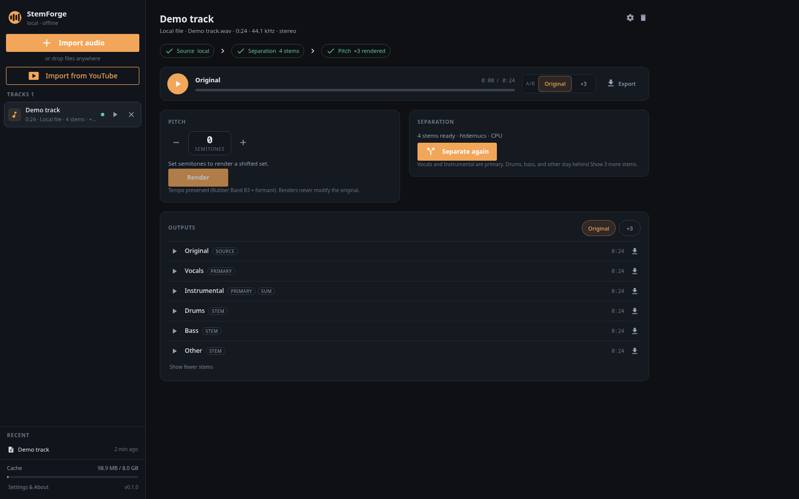
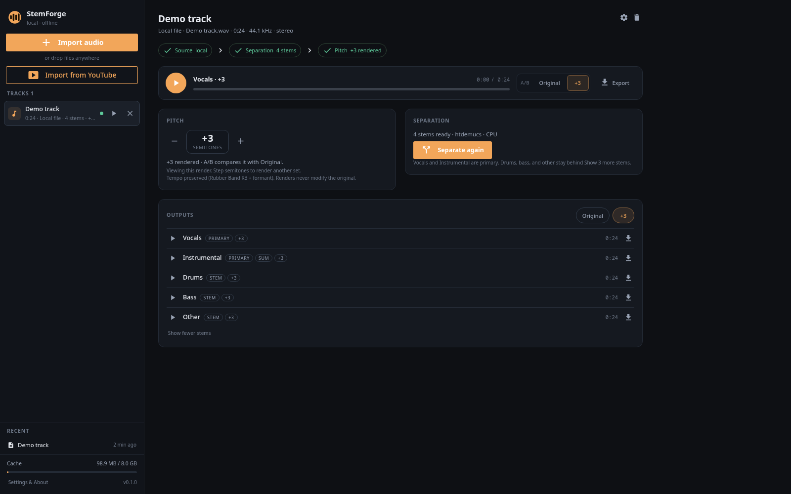

# StemForge Design System

The visual language of the StemForge desktop shell: the palette, the type, the component patterns,
and the layout rules an agent needs before changing `src/stemforge/ui/`. This document mirrors the
shipped language; it is not a redesign brief.

`src/stemforge/ui/theme.py` is canonical. Every value below comes from there, from `SHELL_CSS` in
`src/stemforge/ui/page.py`, or from the component that owns the pattern. If the code and this
document disagree, the code is right and this document is stale. The token-table test in
`tests/unit/test_design_doc.py` keeps the palette and geometry that a test can check from drifting.

Scope is the app shell. The README and any future marketing page have their own visual language and
are out of scope.

## 1. Visual Theme and Atmosphere

StemForge is a dark, compact, tool-like desktop application. The window is a working surface, not a
landing page: a fixed left rail holds the library and the global actions, a main pane holds the
selected Track, and a single Job bar sits at the bottom. Surfaces are near-black neutrals separated
by one-pixel lines, so the audio rows and the controls carry the hierarchy rather than decoration.

Warm amber is the only accent. It marks the action that moves the task forward, the active version
tab, the selected Track, and progress. Everything else is a neutral, a state colour, or ink on an
amber field. The accent is deliberately scarce: when two amber fills compete on one surface, neither
reads as primary.

The app is not a marketing site. There is no hero, no gradient, no glass, no playful illustration,
no oversized display type, and no light theme. The one image in the shell is the Badge, an amber
disc with four ink bars; it appears in the rail and in Settings & About.

*The Workspace after a Separation. The rail-and-detail shell keeps the Track list, the transport,
and the Outputs card in one window.*

*A +3 semitone Render, with the version tab active and A/B available in the transport. The amber
accent appears on the active tab, the primary action, and the progress fill, nowhere else.*

## 2. Colour Palette and Roles

The palette is one custom-property block, `theme.TOKENS_CSS`. `theme.apply()` maps the same values
onto Quasar's semantic names before the shell renders, so default-coloured buttons, sliders,
progress bars, switches, and focus rings inherit the amber accent instead of Quasar's blue.

### Token reference

| Token | Value | Role |
| --- | --- | --- |
| `--bg` | `#0e1014` | Base canvas, main pane, and the read-only licence text field |
| `--rail` | `#11141a` | Left rail, rail footer, Job bar, and Export status bar |
| `--panel` | `#151920` | Cards and the transport |
| `--panel2` | `#1b2029` | Hovered and selected rows, track icon tile, playing output row |
| `--line` | `#242b36` | Standard one-pixel separator and card border |
| `--line2` | `#313b49` | Stronger outline for chips, tabs, fields, and selected rows |
| `--line-hover` | `#55647a` | Interactive outline on hover |
| `--text` | `#e6e9ef` | Primary text |
| `--muted` | `#98a2b3` | Secondary text and the resting ink of a flat control |
| `--dim` | `#6c7686` | Tertiary metadata and uppercase labels |
| `--accent` | `#f2a65a` | Amber: primary action, active tab, selection, and progress |
| `--accent-soft` | `rgba(242, 166, 90, 0.12)` | Tinted fill for an active control or row |
| `--accent-line` | `rgba(242, 166, 90, 0.4)` | Accent border and inset ring |
| `--accent-deep` | `#3a2c14` | Inset well inside the selected format radio |
| `--good` | `#5ec99a` | Success state, completed dot, and Export success icon |
| `--good-soft` | `rgba(94, 201, 154, 0.12)` | Success tint; no current rule consumes it |
| `--good-line` | `#2f4636` | Success border on a completed chip |
| `--bad` | `#ef7070` | Failure state and failure dot |
| `--bad-text` | `#f3a5a5` | Failure headline and inline field error |
| `--bad-action` | `#c9a6a6` | Failure action line |
| `--bad-dim` | `#a97f7f` | Failure detail, unavailable name, and failure code |
| `--bad-soft` | `rgba(239, 112, 112, 0.1)` | Failure tint; no current rule consumes it |
| `--bad-bg` | `#241617` | Inline error surface and failed Export bar |
| `--bad-line` | `#5b2c2c` | Inline error border |
| `--warn` | `#e4d3a9` | Warning, stall, stale-tab, and degraded text |
| `--warn-bg` | `#1d1a12` | Banner, stall, and degraded surface |
| `--warn-line` | `#40341d` | Warning surface border |
| `--ink` | `#1d1204` | Text and icons on amber and on state fields |
| `--well` | `#12161d` | Recessed field inside a card |
| `--radius` | `12px` | Card, transport, and drop-zone radius |
| `--mono` | `ui-monospace, SFMono-Regular, Menlo, Consolas, monospace` | Numbers, paths, codes, and licence text |
| `--control-h` | `32px` | Compact control height |
| `--control-min-w` | `44px` | Compact control minimum width |
| `--control-pad-x` | `12px` | Compact control inline padding |
| `--control-icon` | `32px` | Square icon-control box |
| `--control-primary-h` | `36px` | Primary control height |
| `--control-primary-min-w` | `120px` | Primary control minimum width |
| `--control-primary-pad-x` | `16px` | Primary control inline padding |
| `--control-font` | `11px` | Compact control label size |
| `--control-primary-font` | `12.5px` | Primary control label size |

### Surfaces

`bg` is the canvas and the main pane. `rail` frames the left edge and the two bottom bars; it is
deliberately close enough to `bg` to read as chrome rather than as another card. `panel` is the card
surface, including the transport. `panel2` is one step up from `panel`, used for a hovered or
selected row, the icon tile behind a Track, and the row that is currently playing. `well` is not a
higher step: it is the recessed field inside a card, used for the drop zone, the model gate, the
semitone readout, the A/B switch, and a format row.

### Lines and text

`line` draws standard separators and card borders. `line2` draws a control or chip outline that
needs to read as interactive without using the accent. `line-hover` is the hover outline for those
controls. Text has three levels: `text` for names and values, `muted` for secondary prose and
flat-control ink, and `dim` for metadata, uppercase labels, and fineprint. Muted and dim are not
interchangeable: use `muted` whenever the user must read the line, and reserve `dim` for support
text.

### Accent

`accent` marks the primary action, the active version tab, the selected Track's icon, the active
side of A/B, the running Job dot, and progress fills. `accent-soft` is its tinted fill for an active
state; `accent-line` is the border or inset ring around that state. `accent-deep` is the inset
inside the selected format radio, where the ring needs a dark centre.

### State colours

`good` and its `good-line` border mark completion: the check on a completed signal-path chip, the OK
track dot, and the Export success icon. The `bad` family marks failure in layers: `bad-text` for the
headline, `bad-action` for what to do next, `bad-dim` for the raw detail and an unavailable name,
`bad-bg` and `bad-line` for the surface. The `warn` family marks caution rather than failure: a
stalled Job, a version rendered from an earlier Separation, and the degraded-mode banner that
announces missing playback.

### Ink

`ink` is the near-black text and icon colour for amber and state fields: `.q-btn.bg-primary` and
`.q-btn.bg-negative` both take it, so a filled button never carries white text. It is never a
surface colour.

### Rules

- Amber is the only accent. It marks the primary action, the active tab, selection, and progress.
- `good` and `bad` are state colours, never decoration.
- Quasar's blue `primary` must never appear; `theme.apply()` replaces it before the shell renders.
- No new hex literal outside `theme.py`. If a new role is needed, add it to the token block first,
  then use the token.
- Do not lower contrast further than the shipped pairs. If a shipped pair fails WCAG AA, record it
  under Known exceptions rather than presenting it as intentional.

### Known exceptions

`--dim` on the shell surfaces measures roughly 3.6:1 to 4.2:1, below the 4.5:1 AA threshold for
normal text. It is used at 9–11.5 px for metadata, uppercase labels, and fineprint. The shipped pair
is recorded here as a known exception, not as an intentional low-contrast style: use `--muted` for
anything a user must read, and fix the dim pairs in a dedicated accessibility change rather than
presenting the current ratio as a rule.

## 3. Typography Rules

The body stack is `Inter, system-ui, -apple-system, "Segoe UI", sans-serif`, declared once on
`.sf-shell`. Numbers, paths, codes, and the licence text use `--mono`. There is no font loading and
no `@font-face`: the app uses whatever the host has, and Inter is a preference rather than a
dependency.

### Hierarchy

| Role | Size | Weight | Representative classes | Notes |
| --- | --- | --- | --- | --- |
| Empty-state title | 24 px | 650 | `sf-empty-title` | Only the empty state uses this size; tracking is -0.02em |
| Detail and modal title | 19 px | 650 | `sf-title` | Detail header, Settings, consent, and remove dialogs; tracking is -0.01em |
| Export sheet title | 18 px | 650 | `sf-export-title` | The sheet's own heading |
| Numeric display | 20 px | 650 | `sf-semi-value` | Semitone value, mono, line-height 1.15 |
| Brand name | 15 px | 650 | `sf-brand-name` | Tracking is -0.01em |
| Brand subtitle | 10.5 px | 400 | `sf-brand-sub` | Dim; the only prose under the mark |
| Section and card label | 10–10.5 px | 600 | `sf-card-title`, `sf-rail-label`, `sf-versions-label` | Uppercase, 0.08em tracking, dim |
| Record title | 12.5 px | 550–600 | `sf-track-title`, `sf-output-name`, `sf-now-title`, `sf-setting-label`, `sf-format-name` | One line with ellipsis where the row can shrink |
| Body | 12–13 px | 400 | `sf-fact`, `sf-banner`, `sf-lede` | The lede is 13 px; card facts and banner prose are 12 px |
| Metadata | 10.5–11.5 px | 400 | `sf-track-meta`, `sf-detail-meta`, `sf-separation-status`, `sf-pitch-status` | Muted or dim, depending on whether it must be read |
| Fineprint | 10 px | 400 | `sf-fineprint`, `sf-recent-meta`, `sf-level-badge` | Dim; hints, counts, and timestamps |
| Badge | 9–10 px | 400–600 | `sf-stem-badge`, `sf-ab-label`, `sf-semi-unit` | Uppercase with 0.06–0.08em tracking |
| Button | 11 px | 400–600 | `--control-font` | Compact controls; the primary control is 12.5 px and 600 |
| Numeric and progress | 10.5 px | 400 | `sf-job-pct`, `sf-transport-time`, `sf-output-duration`, `sf-gate-meta` | Mono; aligns in columns and does not jitter while playing |

### Rules

- No new font size without a pattern that already uses it. If the pattern genuinely needs a new
  size, add it to the token block first. The scale is deliberately narrow; a new size is a design
  change, not a local tweak.
- No inline `font-size` overrides on compact controls. Quasar's `size=sm` writes an inline font size
  that a stylesheet cannot override, which is why `sf-control` exists. Use the class, not the prop.
- Use weights 550, 600, and 650. Do not introduce 700 or 800; the shell is dense and heavy weights
  make rows fight each other.
- Uppercase is for labels and badges only, always with positive tracking. Never set body prose in
  uppercase.
- Use mono for anything numeric, any path, any code, and the licence text.
- No italics, no decorative text shadows, and no letter-spacing on body text.

## 4. Component Stylings

The shell has roughly 150 `sf-` classes. They are not a class-by-class API; they are a small set of
patterns. Reuse a pattern and copy its representative classes rather than inventing a parallel one.

### Buttons

**Anatomy.** `sf-control` owns the compact box: 32 px height and minimum height, 44 px minimum
width, 12 px inline padding, 11 px label at line-height 1. `sf-control--icon` makes a square 32 px
icon button with no padding. `sf-control--primary` makes the primary box: 36 px, 120 px minimum
width, 16 px inline padding, 12.5 px at weight 600.

**States.** The default `unelevated` button uses Quasar's `primary`, which the theme has already
turned amber, and `.q-btn.bg-primary` sets its text to `ink`. A neutral `flat` control uses `muted`
and moves to `text` on hover. Focus and ripple come from Quasar's primary-derived colours; do not
remove them. The disabled state is Quasar's own opacity and pointer behaviour, reached through
`set_enabled(False)`. The active state for a tab or A/B side is the `is-active` class, not a
pressed-button style.

**Classes.** `sf-control`, `sf-control--icon`, `sf-control--primary`; `sf-primary-button` only adds
weight 600 to the full-width rail Import button.

**Do.** Use one primary-sized action per surface. Use `sf-control--icon` for a round icon button and
`sf-control` for a labelled flat action. Use `color=negative` only for the destructive confirmation.

**Don't.** Do not add `size=sm` or a raw height to a control that has `sf-control`; the inline style
wins. Do not use a second primary-sized amber action on the same card. A compact amber Retry beside
a primary action is acceptable because it repeats the same request; a third amber control is not.

### Pills, chips, and version tabs

**Anatomy.** `sf-chip` is a status pill: inline flex, 4 px by 9 px padding, a `line2` border, a 999
px radius, and `muted` text. A chip in the signal path carries an icon, a label, and a value.
`is-done` switches the border to `good-line` and the text to `good`. `sf-version-tab` is a flat,
dense button with a pill radius; the active tab adds `accent-soft`, `accent-line`, and `accent`.
`sf-stem-badge` is the compact uppercase Artifact badge at 9 px; `sf-level-badge` is the 10 px dim
note for an adjusted presentation level.

**States.** A version tab is default, hover (Quasar's flat hover moves the text toward `text`),
active, stale, and stale-active. Stale means the Render was built from an earlier Separation: the
border turns dashed and the text `warn`. When a stale tab is also active, the accent owns the border
colour and text, and the dashed outline plus the appended label still carry the warning.

**Classes.** `sf-chip`, `sf-chip-label`, `is-done`; `sf-version-tab`, `sf-tabs`, `is-active`,
`is-stale`; `sf-stem-badge`, `sf-level-badge`.

**Do.** Keep the pill vocabulary for short status nouns and version labels. Let the label carry the
state in words as well as colour.

**Don't.** Do not use `good` for an inactive chip, do not use a chip as a button, and do not mix a
version tab with a formatting-row look.

### Cards and panels

**Anatomy.** `sf-card` is the one card surface: a one-pixel `line` border, the 12 px `--radius`,
`panel` background, and 16 px padding. `sf-card-head` is the header row: flex, space-between, 12 px
gap, 10 px bottom margin. `sf-card-title` is the uppercase 10.5 px label; inside a head it loses its
own bottom margin.

**States.** Cards are static. They do not lift on hover, and the shell's own cards do not carry a
shadow. Dialog cards are Quasar `q-card`s and currently inherit Quasar's default shadow; that is an
unresolved inconsistency, not an elevation rule. A card's state is expressed by its contents: a
notice, a progress bar, or an active row inside it.

**Classes.** `sf-card`, `sf-card-head`, `sf-card-title`; the detail card also uses `sf-detail` for
its 18 px vertical rhythm and `sf-two-up` for a side-by-side pair.

**Do.** Use a card for a Track-level group: Pitch, Separation, Outputs, transport. Use `well` inside
it for a field.

**Don't.** Do not nest cards, do not add elevation, and do not give a card a second background
token.

### Track rows and recent rows

**Anatomy.** `sf-track` is a 7 px-padded flex row with a 9 px gap, a transparent one-pixel border,
and an 8 px radius. The clickable `sf-track-hit` holds a 26 px icon tile, an `sf-track-main` column,
and a status `sf-dot`. The title is 12.5 px at weight 550; the metadata is 10.5 px dim. Both
ellipsis. `sf-track-remove` is opacity 0 until the row is hovered or selected. `sf-recent-row`
repeats the pattern one level smaller: `sf-recent-hit` hovers to `panel2`, the title is 11.5 px, and
the metadata is 10 px.

**States.** A track row is default, hover (`panel2`), selected (`panel2` plus a `line2` border, with
the icon tile turning `accent-soft`/`accent`). A recent row can be available, missing, or off;
missing and off drop to 0.55 opacity, and a blocked hit uses `is-disabled` with a default cursor.
The dot is `dim` by default, `good` after a successful Separation, `accent` while a Job runs, and
`bad` after a failure.

**Classes.** `sf-track`, `sf-track-hit`, `sf-track-main`, `sf-track-title`, `sf-track-meta`,
`sf-track-ic`, `sf-track-remove`, `sf-dot`, `is-selected`, `is-ok`, `is-run`, `is-bad`; `sf-recent`,
`sf-recent-row`, `sf-recent-hit`, `sf-recent-title`, `sf-recent-meta`, `is-missing`, `is-off`,
`is-disabled`.

**Do.** Keep the play and remove controls outside the hit target so a row click selects rather than
plays. Use the dot with adjacent status text.

**Don't.** Do not make the whole row a button, do not use amber for a resting dot, and do not add a
second line of metadata.

### Output rows

**Anatomy.** `sf-output-row` is a 40 px-minimum flex row with a one-pixel top `line` separator; the
first row has no separator. The main column wraps a 12.5 px name, a badge cluster, and, when needed,
a repair line. The duration is 10.5 px mono dim. The play and export controls are compact round icon
buttons. They use Quasar's `size=sm` rather than `sf-control--icon`, so their geometry is Quasar's,
not the shared 32 px compact box; do not copy that as the pattern.

**States.** The stylesheet defines `is-active` and `is-playing`, both a `panel2` background with an
8 px radius. The page applies only `is-playing`; `is-active` is dormant because the version tab is
the authority for which Artifact set is displayed. `is-unavailable` moves the name to `bad-dim` and
shows `sf-output-repair`, which names the repair in `warn` and offers the matching action. A
not-yet-separated Track shows `sf-placeholder`, a dashed `line2` row.

**Classes.** `sf-output-row`, `sf-output-main`, `sf-output-name`, `sf-output-badges`,
`sf-output-repair`, `sf-output-duration`, `is-playing`, `is-unavailable`, `sf-placeholder`.

**Do.** Show the two primary outputs and the Original first; reveal the secondary Stems behind Show
all. Give every unavailable row a repair that says what will fix it.

**Don't.** Do not apply an `is-active` row state; the dormant rule in `SHELL_CSS` is not a pattern
to copy, and the active tab already says which version is on screen. Do not use a spinner or a
generic failure icon for unavailable; the named repair is the state.

### Transport and A/B

**Anatomy.** `sf-transport` is a `panel` card with a `line` border, the 12 px radius, 12 px by 14 px
padding, and a 14 px flex gap. The 42 px round play button is the one large control.
`sf-transport-main` holds a baseline line and the seek slider. `sf-now-title` is 12.5 px at weight
600 and ellipses; the time is 10.5 px mono dim; `sf-progress` is the slider with a 5 px track, no
thumb, an accent selection, and a `line` remainder. `sf-transport-right` holds the A/B group and the
compact Export button. `sf-ab` is a `well` field with a `line` border, 8 px radius, and 2 px
padding; its label is 9.5 px uppercase dim. `sf-ab .q-btn.is-active` adds `accent-soft`, `accent`,
and an inset `accent-line` ring.

**States.** Play toggles between play and pause. The slider is disabled when there is no preview or
the host is degraded. A/B has one active side: Original or the latest Render. When the active
version is not the latest Render, neither side is lit rather than mislabelling it. One hidden
`<audio>` element, `.sf-player`, serves the whole page with `preload=none`; changing versions resets
its source and position.

**Classes.** `sf-transport`, `sf-play-lg`, `sf-transport-main`, `sf-transport-line`, `sf-now-title`,
`sf-transport-time`, `sf-progress`, `sf-transport-right`, `sf-ab`, `sf-ab-label`, `is-active`,
`sf-player`.

**Do.** Keep one player and one transport for the page. Route every play action through the same
preview state.

**Don't.** Do not add native audio controls, do not create a second `<audio>`, and do not carry a
playback position across a version change.

### Job bar and progress

**Anatomy.** `sf-jobbar` is the one bottom bar for a running Job: `flex: none`, 44 px minimum
height, `rail` background, a top `line` border, 6 px by 16 px padding, and a 12 px gap. It carries a
running `sf-dot`, an 11.5 px job line (ellipsised at 42%), an optional 10.5 px detail (34%), a
flexible linear progress, a 10.5 px mono percentage in a 38 px column, and a compact Cancel. The
rail's cache meter is `sf-bar`: a 4 px `line` track with an `accent` fill.

**States.** The bar is present only while a Job is active; otherwise the same bottom slot is empty
or shows the Export status bar. The progress value is the Job's own progress, never a simulated
value. A stalled Separation adds `sf-stall` inside its card rather than replacing the bar.

**Classes.** `sf-jobbar`, `sf-job-text`, `sf-job-detail`, `sf-job-progress`, `sf-job-pct`,
`sf-dot is-run`, `sf-bar`; `sf-progress` belongs to the transport, not the Job bar.

**Do.** Keep one Job bar for the one active Job. Use `sf-bar` for a passive meter and `sf-progress`
for the seek control.

**Don't.** Do not stack a second progress bar, add a spinner, or move the Job bar into a card.

### Drop zone and empty state

**Anatomy.** `sf-empty` centres its child in the main pane. `sf-empty-card` is `min(560px, 100%)`
wide with a 14 px gap: a 24 px title, a 13 px `muted` lede, the drop zone, an optional YouTube row,
and an optional model note. `sf-dropzone` is a `well` field with a dashed `line2` border, the 12 px
radius, 30 px by 20 px padding, centred content, and a 6 px gap. Inside are a `muted` upload icon, a
13 px weight-600 title, and 11.5 px `muted` subtext.

**States.** The drop zone is default, hover (`panel2` with an `accent-line` border), and disabled
(`is-disabled`: 0.55 opacity, default cursor, no click). The empty state is the only place in the
shell that uses 24 px type.

**Classes.** `sf-empty`, `sf-empty-card`, `sf-empty-title`, `sf-lede`, `sf-dropzone`,
`sf-drop-icon`, `sf-drop-title`, `sf-drop-sub`, `is-disabled`, `sf-model-card`, `sf-or`.

**Do.** Keep the empty state to one action and one alternative import path. Use `sf-or` as the
divider with its one-pixel rules.

**Don't.** Do not add illustration, a hero image, or a second primary action in the empty state.

### Notices, warnings, and errors

**Anatomy.** `sf-notice` is the inline failure card: `bad-line` border, `bad-bg` surface, 10 px
radius, 12 px by 14 px padding, 5 px gap, and a 16 px bottom margin. Its headline is 12.5 px weight
600 `bad-text`; the action is 11.5 px `bad-action`; the Details disclosure holds the 10.5 px mono
`bad-dim` code, job, and log path. `sf-stall` is the warning card: `warn-line` border, `warn-bg`
surface, 10 px radius, 10 px by 12 px padding; its text is 11.5 px `warn`. `sf-banner` is the
full-width top banner with a `warn-bg` surface, a bottom `warn-line` border, 10 px by 14 px padding,
and 12 px `warn` text; `sf-banner-degraded` is the degraded-mode variant with a volume-off icon, a
12 px weight-600 headline, and a 10.5 px hint. `sf-field-error` is inline validation text in
`bad-text`.

**States.** A failure is persistent until a later attempt replaces it; a toast may announce it, but
the inline notice is the durable record. The Details disclosure is collapsed by default and holds
the raw code and log actions. Degraded mode is announced at the top of the main pane, never silently
hidden.

**Classes.** `sf-notice`, `sf-notice-headline`, `sf-notice-action`, `sf-notice-detail`,
`sf-details`, `sf-details-actions`; `sf-stall`, `sf-stall-text`; `sf-banner`, `sf-banner-degraded`,
`sf-banner-text`, `sf-banner-headline`, `sf-banner-hint`; `sf-field-error`, `sf-unavailable`.

**Do.** Say what failed and what to do next in the headline and action. Put the raw detail behind
Details. Use `warn` for caution and `bad` for failure.

**Don't.** Do not signal failure with colour alone, do not show a raw trace or an unlabelled icon,
and do not use a modal for a failure that belongs inline.

### Toasts and dialogs

**Anatomy.** Toasts are Quasar notifications with the shell's semantic colours, an eight-second
lifetime, and a close button. Dialogs are a `ui.dialog` with a `ui.card().classes("sf-card ...")`:
`sf-export-modal` is `min(480px, 94vw)`, `sf-youtube-modal` is `min(560px, 94vw)`, `sf-settings`
names the Settings & About card, `sf-diagnostics` is `min(720px, 94vw)`, and a remove confirmation
is the plain `sf-card` with an `sf-title` and `sf-lede`. A document dialog reuses
`sf-settings about-document` and shows the text in `pre.sf-licence-text`: mono 11 px, `bg`, a `line`
border, an 8 px radius, and a 58vh maximum height. The model gate is inline, not a modal: `sf-gate`
is a `well` field with a `line2` border, 10 px radius, 6 px gap, and 12 px padding; its title is 13
px weight 600, its summary 11.5 px, its metadata 10.5 px mono, and its notice 11 px `warn`.

**States.** A long document scrolls inside its own `pre`, not in the page. The consent dialog is a
one-time gate; declining disables the YouTube surfaces for the session rather than showing the
dialog again.

**Classes.** `sf-export-modal`, `sf-export-body`, `sf-export-footer`, `sf-export-confirm`;
`sf-settings`, `sf-settings-mark`, `sf-licence-text`; `sf-youtube-modal`, `sf-gate`,
`sf-gate-title`, `sf-gate-summary`, `sf-gate-meta`, `sf-gate-notice`.

**Do.** Use a dialog for a flow that needs confirmation: Export, YouTube consent, remove, licence
documents, diagnostics. Keep the toast for transient acknowledgement.

**Don't.** Do not use a modal for an inline failure, do not nest dialogs, and do not put page
scrolling inside a dialog.

### Settings, format, and YouTube rows

**Anatomy.** `sf-setting-row` is a flex row with space-between, a 16 px gap, and 8 px vertical
padding. `sf-setting-main` is a 2 px-gap column: a 12.5 px weight-550 label and a 10 px `dim` value
or hint. There is no divider; the spacing carries the grouping. `sf-format-row` is a `well` field
with a `line2` border, 9 px radius, 7 px by 10 px padding, and a 10 px gap: a 12 px radio, a
`sf-format-main` column with a 12.5 px name and a 10.5 px `muted` size estimate. `sf-yt` is a 7
px-gap column; `sf-yt-row` is a stretch flex row with an 8 px gap, a dense outlined input, and a
primary import button. The field error is 11.5 px `bad-text`, the status 11.5 px `good`, and the
disclaimer 11 px `dim` at line-height 1.45.

**States.** A format row is default, hover (`line-hover` border), and active (`accent-line` border,
`accent-soft` fill, filled `accent` radio with an `accent-deep` inset). A YouTube field is default,
busy (input and button disabled), declined (disabled with a status line), and error (inline
`sf-yt-error` plus Details).

**Classes.** `sf-setting-row`, `sf-setting-main`, `sf-setting-label`; `sf-format-list`,
`sf-format-row`, `sf-format-radio`, `sf-format-main`, `sf-format-name`, `sf-format-size`,
`is-active`; `sf-yt`, `sf-yt-row`, `sf-yt-input`, `sf-yt-button`, `sf-yt-error`, `sf-yt-status`,
`sf-yt-disclaimer`.

**Do.** Use a setting row for a label and its value or action. Use a format row for a mutually
exclusive choice with a size estimate.

**Don't.** Do not introduce a new row shape for one control, and do not use a format row as a plain
button.

## 5. Layout Principles

The shell is a two-column grid: a fixed 292 px rail and a `minmax(0, 1fr)` main pane, at 100vw by
100vh. Below 1150 px the rail steps to 260 px. The shell has `overflow: hidden`; every scrollable
region owns its own scrollbar.

The rail stacks the brand, the Import actions, the Track list (flexible), the Recent list (up to
38vh), and the cache footer. Its paddings are 16 px by 16 px by 10 px for the brand, 4 px by 12 px
for the add block, 12 px by 8 px for the Tracks, 10 px by 8 px for Recent, and 10 px by 14 px by 12
px for the footer.

The main pane stacks an optional banner, `sf-scroll`, the Job bar, and the hidden player.
`sf-scroll` owns the main scroll: 24 px top, 28 px right, 28 px bottom, and 28 px left. Inside it,
`sf-detail` is capped at 980 px and uses an 18 px vertical rhythm: header, signal path, transport,
the `sf-two-up` Pitch and Separation pair, then Outputs. `sf-two-up` is two equal columns with an 18
px gap, collapsing to one column at the same 1150 px step.

Cards use the 12 px `--radius` and 16 px padding. The window is 1280 by 820 by default with a 1024
by 700 minimum, set in `integration/window.py`; the shell must stay usable at the floor, not only at
the default. The Job bar is at least 44 px tall; the Export status bar occupies the same slot when
no Job is running.

The gap scale in use is 1, 2, 4, 5, 6, 7, 8, 9, 10, 12, 14, 16, and 18 px. Read it as: 1–2 px for
hairline offsets, 4–6 px inside a control or a tight stack, 8–10 px between controls and inside a
row, 12–14 px for control padding and group gaps, 16 px for card padding and headers, and 18 px
between detail sections. Larger values belong to a named surface: 20 and 30 px for the drop zone, 24
and 28 px for the main scroll padding. Do not invent an intermediate step for one composition.

New content belongs in one of four places:

- A Track-level group goes in a card in the main pane, in the detail rhythm.
- A global control goes in the rail, below the brand and above the Track list.
- A Job-level surface goes in the Job bar slot at the bottom of the main pane.
- A flow that needs confirmation goes in a modal card.

## 6. Depth and Elevation

The shell is flat. Depth comes from a surface step and a one-pixel border, not from a drop shadow.
The named surfaces run `bg` → `rail` → `panel` → `panel2`, with `well` as the recessed field inside
a card. `panel2` is the selected or hovered step above `panel`; `well` is darker than `panel`
because it is a recess, not a height.

Use a border when a region needs an edge: `line` for cards and passive separators, `line2` for an
interactive control or a selected row, and `line-hover` for the hover outline of a field. Step the
surface when the region is a card (`panel`), a hovered or selected row (`panel2`), or a field inside
a card (`well`). Use the rail surface for chrome and bottom bars, not for content cards.

There is no drop shadow on the shell's own surfaces. The only shadows there are rings: the inset
`accent-line` on the active A/B side, the `accent-deep` inset in the selected format radio, and
Quasar's focus ring. Dialog cards currently inherit Quasar's `q-card` shadow; treat that as debt,
not as elevation. Do not add elevation to a card, a dialog, or a bar. The near-black palette has
little room for a shadow to read, and a shadow on a dense row makes the row look detached from its
list.

## 7. Do's and Don'ts

### Do

- Do use `theme.py` tokens and the `sf-` patterns before adding a class.
- Do keep compact controls at the shared 32 px and 36 px geometry.
- Do use amber for one primary-sized action per surface.
- Do announce a degraded capability in the UI, at the top of the main pane.
- Do use `sf-control` for the compact box instead of Quasar's `size=sm`.
- Do use mono for time, percentages, semitones, paths, and codes.
- Do keep the 12 px card radius and reuse the smaller 6, 8, 9, and 10 px radii already attached to a
  pattern.
- Do give an unavailable Artifact a named repair.
- Do add or update a UI test under `tests/ui/` for a visible change.

### Don't

- Don't show Quasar blue, gradients, glass, or decorative shadows.
- Don't add a colour literal outside `theme.py`.
- Don't use colour alone to signal state; pair it with a label or an action.
- Don't introduce a new font size or radius without a pattern that already uses it; a genuinely new
  size goes into the token block first.
- Don't use inline styles where a token or class exists.
- Don't add `size=sm` to a control that is already `sf-control`.
- Don't add a second `<audio>` element or per-row native controls.
- Don't let the page scroll; scroll the rail lists and the main pane.
- Don't use a modal for an inline failure.
- Don't add a marketing hero, a light theme, or a decorative illustration.

## 8. Responsive Behaviour

This is a desktop window, not a responsive website. The window opens at 1280 by 820 and has a 1024
by 700 floor; it is resizable between them and larger. The shell does not reflow for a phone, has no
mobile breakpoints, no hamburger menu, and no touch-specific layout.

There is one breakpoint: at 1149.98 px and below, the rail steps from 292 px to 260 px and
`sf-two-up` collapses from two columns to one. That keeps the main pane usable at the 1024 px floor.
Above the breakpoint, the detail remains capped at 980 px rather than stretching to the far edge.

Content scrolls inside its region. The rail's Track list and Recent list scroll independently; the
main pane scrolls in `sf-scroll`; the Job bar and the rail footer stay put; document dialogs scroll
inside their `pre`. The page itself never scrolls, and the shell never grows past 100vh.

Long values truncate rather than push a control out of reach: Track titles, metadata, the
now-playing title, and Job text each ellipsis. The Job bar caps its primary text at 42% and its
detail at 34%, so Cancel and the percentage stay visible. At the 1024 px floor, the rail leaves
roughly 764 px for the main pane; the two-up pair has already collapsed, and action rows wrap
through `sf-actions`.

## 9. Agent Prompt Guide

Before adding or changing UI, work through this list:

1. Read `src/stemforge/ui/theme.py`, the relevant rules in `SHELL_CSS` in
   `src/stemforge/ui/page.py`, and this document.
2. Reuse a token and an existing `sf-` pattern. Name the pattern in the change; do not invent a
   parallel class for the same job.
3. If a genuinely new token is needed, add it to the token block (`theme.TOKENS_CSS`) first and
   update the token table here in the same change. The token-table test compares the two.
4. Keep the compact geometry. Use `sf-control`, `sf-control--icon`, and `sf-control--primary`; do
   not reach for Quasar's `size=sm`.
5. Add or update a UI test under `tests/ui/` that pins the visible behaviour or the marker, not the
   CSS string.
6. Run `scripts/check.sh`; the design-doc test must pass.
7. If the change is visual, capture a screenshot for the pull request description only; never commit
   it as an asset.
