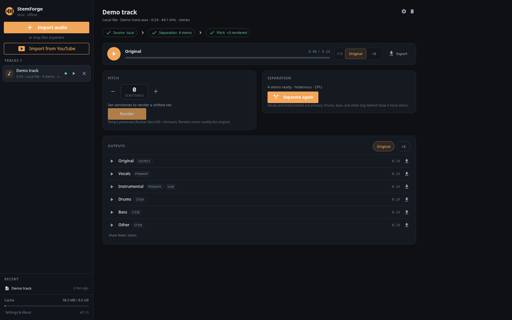
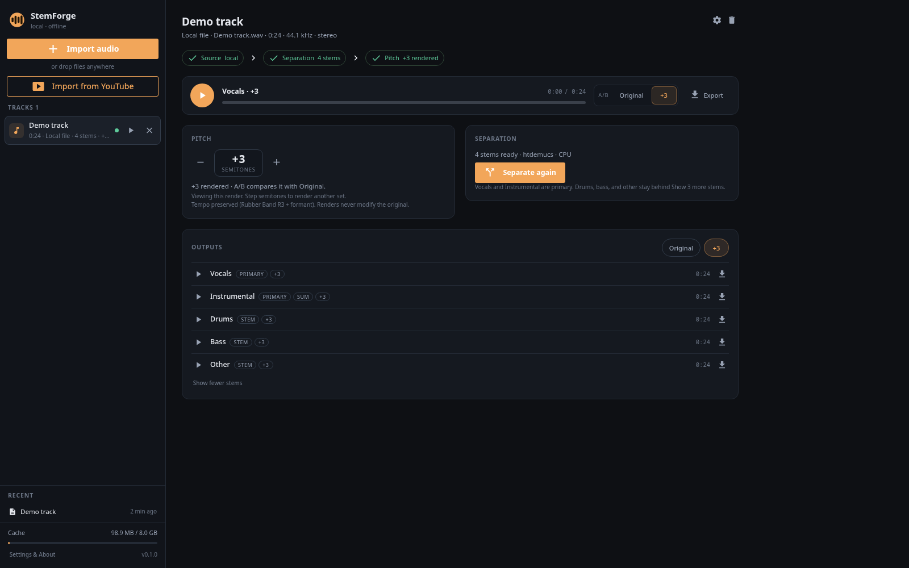

<p align="center">
  
</p>

<h1 align="center">StemForge</h1>

<p align="center">
  <b>Local stem separation, pitch shifting, and export.</b><br>
  Take a song apart on your own machine: four stems, an Instrumental, and pitch-shifted
  versions, with no account and no upload.
</p>

<p align="center">
  
  
  
  
</p>

<p align="center">
  <a href="https://github.com/alexmarincu/stemforge/releases/latest"><b>Download StemForge</b></a> ·
  <a href="#what-it-does">What it does</a> ·
  <a href="#screenshots">Screenshots</a> ·
  <a href="#download">Download</a> ·
  <a href="#how-it-works">How it works</a> ·
  <a href="#build-from-source">Build from source</a> ·
  <a href="#contributing">Contributing</a>
</p>

## What it does

StemForge is a desktop app for taking a song apart. Import an audio file — or a YouTube
link — and StemForge separates the Track into four Stems: vocals, drums, bass, and
other. Vocals and Instrumental are the two primary outputs. From there you can shift
pitch by up to twelve semitones without changing tempo, preview every version against
the original, and export WAV, FLAC, or MP3.

Everything runs on your machine. There is no account and no telemetry, and your audio
is never uploaded. StemForge uses the network only to download the separation model
once, after you accept the model notice, and — if you use YouTube import — to fetch the
single video you ask for. YouTube import is consent-gated and can be turned off in
Settings.

## Screenshots

<p align="center">
  
</p>
<p align="center">
  <sub>The Workspace after a Separation: the Original source, then Vocals, Instrumental, Drums, Bass, and Other.</sub>
</p>

<p align="center">
  
</p>
<p align="center">
  <sub>A +3 semitone Render of all four Stems and the Instrumental, with A/B against the Original in the transport.</sub><br>
  <sub>Screenshots use a synthesised demo track.</sub>
</p>

## Features

<table>
  <tr>
    <td width="33%" valign="top">
      <h3>Four stems, two headline outputs</h3>
      Separation produces vocals, drums, bass, and other. Vocals and Instrumental are
      presented first; the remaining stems are one click away.
    </td>
    <td width="33%" valign="top">
      <h3>Pitch without tempo drift</h3>
      Shift a Track or all of its Stems by ±12 semitones. Rubber Band keeps the tempo
      and preserves formants.
    </td>
    <td width="33%" valign="top">
      <h3>Listen before you commit</h3>
      Preview any Artifact in the app, A/B it against the original or the latest
      Render, then export through a native save dialog.
    </td>
  </tr>
  <tr>
    <td width="33%" valign="top">
      <h3>Your files, or a link</h3>
      Import WAV, MP3, FLAC, or M4A by drag-and-drop. YouTube import is
      consent-gated, accepts one public video at a time, and can be turned off in
      Settings.
    </td>
    <td width="33%" valign="top">
      <h3>Offline by design</h3>
      No account, no telemetry, no upload. The only network use is the one-time model
      download and an import you explicitly ask for.
    </td>
    <td width="33%" valign="top">
      <h3>Jobs you can see and stop</h3>
      Every import, Separation, Render, and Export reports progress and can be
      cancelled. Recent files and the cache are managed in Settings.
    </td>
  </tr>
</table>

## Good to know

- **The separation model is a separate download with no granted licence.** StemForge
  bundles the app, not the weights. The first Separation downloads the pinned
  `htdemucs` weights (84 MB) after a separate notice. The Demucs author says the
  weights' licence is not clear and likely non-commercial, because the training data
  included research-only MusDB material.
- **YouTube import is deliberately narrow.** One public, non-age-gated video per
  import, with no playlists, channels, accounts, or cookies. You confirm you have the
  right to use the content before anything is fetched.
- **A Separation is capped at 30 minutes** of local audio, or 15 minutes for a YouTube
  import. Longer Tracks are refused after probing rather than processed slowly.
- **It runs on the CPU.** A long track takes minutes, not seconds, and progress and
  cancellation stay available throughout.
- **The Workspace is a session, not a project library.** Tracks and their Artifacts
  live in a cache that survives restarts; the list of open Tracks does not.
- **On Linux, Preview needs the GStreamer stack.** Without it StemForge still separates
  and exports, announces the degraded mode in the app, and never fails silently.

## Download

Get the latest build from the [releases page](https://github.com/alexmarincu/stemforge/releases/latest).
Every release includes a `SHA256SUMS` file to check the downloads against. `<ver>` is
the version number from the release tag.

> [!NOTE]
> StemForge is in beta: expect rough edges. `Settings & About` → `Copy diagnostics`
> produces a report you can paste into an issue (it contains local file paths, so
> review it first).

All builds are 64-bit and need a 4-core AVX2 x86-64 CPU, 8 GB of RAM, and 20 GB of
free disk; 16 GB and an SSD are recommended.

**Windows** (10 22H2 or newer, 11)

| File | What it is |
|---|---|
| `StemForge-<ver>-win64-setup.exe` | Installer for most PCs: per-user, no administrator rights. |
| `StemForge-<ver>-win64-portable.zip` | No install: unzip and run `StemForge.exe`. |

StemForge needs Microsoft Edge WebView2, present on current Windows 10 and 11. The
portable ZIP includes the offline bootstrapper. The build is unsigned, so SmartScreen
may warn; check the file against `SHA256SUMS` before choosing **Run anyway**.

**Linux** (x86-64; glibc 2.35 or newer, for example Ubuntu 22.04+, Debian 12+, Fedora
current, Arch current)

| File | What it is |
|---|---|
| `StemForge-<ver>-linux-x86_64.tar.gz` | Portable Bundle: the primary artifact. Extract and run `./run.sh`. |
| `StemForge-<ver>-linux-x86_64.tar.zst` | The same tree, zstd-compressed. |
| `StemForge-<ver>-linux-x86_64.AppImage` | Thin single-file wrapper around the same Bundle. Needs FUSE 2, or run it with `--appimage-extract-and-run`. |

The native window needs host GTK 3, WebKitGTK 4.1 (2.44 or newer), Soup 3, GStreamer,
and a GCC 11+ C++ runtime; StemForge does not bundle them. Without the window stack,
`run.sh` starts the same app in browser mode and prints the URL. The
[Linux packaging notes](packaging/linux/README.md) list the packages and the WebKitGTK
workaround for some NVIDIA drivers.

The first Separation downloads the pinned weights after a model notice; they are not
GPL-licensed (see [Good to know](#good-to-know)). To fetch them in advance, run
`./run.sh --install-model --accept-model-licence` on Linux or
`StemForge.exe --install-model --accept-model-licence` on Windows.

Each release also ships `StemForge-<ver>-src.tar.gz` and the third-party
corresponding-source archive; see [Licence and source](#licence-and-source).

## How it works

StemForge is a Python application: NiceGUI for the interface, pywebview for the native
window, Demucs for Separation, Rubber Band for pitch, and FFmpeg for decoding and
export. Separation runs in a separate worker process, and one queue serialises every
Job so the window stays responsive.

1. **Import** decodes a Source once into a canonical stereo 44.1 kHz float32 WAV in
   the cache. The original file is kept untouched.
2. **Separation** sends overlapping 8-minute blocks to `htdemucs` in the worker,
   crossfades the overlaps, and writes the four Stems plus the Instrumental.
3. **Render** shifts the original Track or all of its Stems with Rubber Band, keeping
   tempo and formants.
4. **Export** copies an Artifact to a location you choose through a native save
   dialog. An Artifact never overwrites the source audio.

The [architecture decision records](docs/adr/) explain why the pipeline looks like
this, from the canonical audio format to the one-worker job queue.

## Build from source

Requires [uv](https://docs.astral.sh/uv/) and Python 3.13.

```sh
git clone https://github.com/alexmarincu/stemforge
cd stemforge
git config core.hooksPath .githooks
uv sync
uv run stemforge
scripts/check.sh
```

That command installs the pre-commit and pre-push hooks: a commit runs the fast
checks and a push runs the full gate. Bypass either with `--no-verify`.
`scripts/check.sh --fast` skips the tests and the full-environment checks.

On Linux, the native window needs GTK 3, WebKitGTK 4.1, and GStreamer installed
system-wide, plus the matching Python bindings in the venv:

```sh
uv pip install pygobject pycairo
```

`scripts/check.sh` syncs with `--inexact`, so it will not remove those bindings.
Without the native stack, `STEMFORGE_BROWSER=1 uv run stemforge` serves the UI at
`http://127.0.0.1:8080`.

`scripts/check.sh` runs the checks CI can make on one machine: the lockfile,
formatting, lint, strict typing, the import contracts, ShellCheck and the
PowerShell parser, the notice and licensing checks, and the unit, UI, and
licensing tests in CI's marker split, followed by a self-test of the installed
app. Integration tests run when `ffmpeg` and `ffprobe` are available; the slow
tests exercise torch and Demucs. Bundle and installer builds live in
[`packaging/`](packaging/), with per-platform instructions for
[Linux](packaging/linux/README.md) and [Windows](packaging/windows/README.txt).

## Project and docs

| Path | What it covers |
|---|---|
| [`GLOSSARY.md`](GLOSSARY.md) | The shared vocabulary: Track, Stem, Instrumental, Separation, Render, Artifact, Export. |
| [`docs/adr/`](docs/adr/) | Accepted architecture decisions and their consequences. |
| [`scripts/check.sh`](scripts/check.sh) | The local CI gate. |
| [`packaging/linux/README.md`](packaging/linux/README.md) and [`packaging/windows/README.txt`](packaging/windows/README.txt) | Frozen Bundle, AppImage, and Windows installer builds. |
| [`docs/agents/`](docs/agents/) | Repository conventions for contributors and coding agents. |

## Contributing

StemForge is in beta, so small, focused fixes are the easiest to review. Bug reports
and feature requests go to [GitHub Issues](https://github.com/alexmarincu/stemforge/issues).
Include your operating system, the StemForge version, and a diagnostics report
(`Settings & About` → `Copy diagnostics`).

Before opening a pull request, run `scripts/check.sh`; it runs everything CI can
check on one machine.

## Licence and source

StemForge is licensed under the GNU General Public License, version 3 only
(`GPL-3.0-only`); see [`LICENSE`](LICENSE).

Every release ships its Corresponding Source and a third-party source archive;
[`SOURCE_OFFER.md`](SOURCE_OFFER.md) explains how to get or request them in writing.
[`THIRD_PARTY_NOTICES.md`](THIRD_PARTY_NOTICES.md) lists bundled components, versions,
licences, and sources. The vendored FFmpeg, ffprobe, Rubber Band, and Deno keep their
own licences. The `htdemucs` weights are not part of the Bundle or its licence; their
notice is shown before the download.
