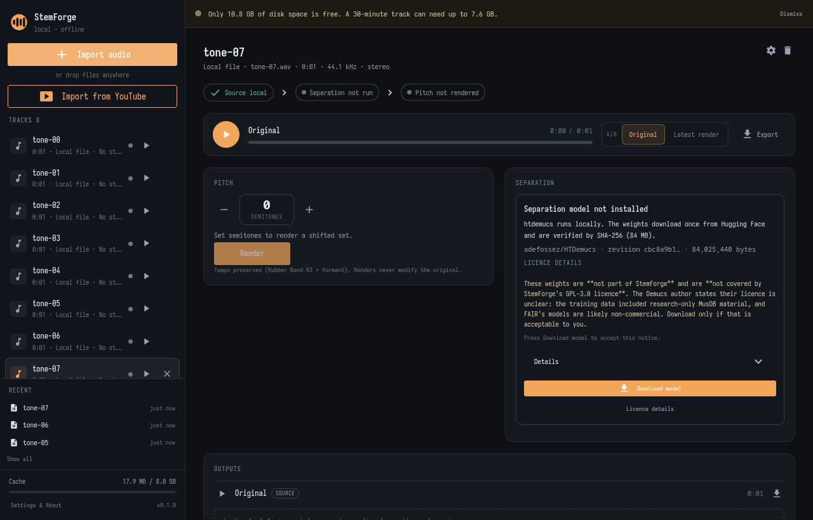

# Linux window rendering: the forced WebKitGTK shared-memory renderer

This is the in-tree verification record for the Linux window workaround in
`configure_window`. It answers five questions with measurements from one host:

1. How much CPU, GPU, and VRAM does the native window use at rest and under
   interaction?
2. How long does an interaction take to show, and does that grow with the window?
3. Where does the large-window time go?
4. Which layer, paint, or style/layout work makes the populated page expensive?
5. Does WebKitGTK still paint a blank white view when the workaround is removed?

The procedures are manual: they need a live X11 session, the real window, and an
unlocked desktop. The unit suite covers the harness's parsing and classification
only. The profile in question 4 also ran on a virtual display while the host
session was locked; that section marks which figures are virtual.

## Host

| Item | Value |
| --- | --- |
| System | Archcraft rolling, Linux x86_64 |
| Session | X11, bspwm, picom |
| Screen | 3640x1920 across two monitors |
| GPU | NVIDIA Quadro K610M (GK208, 1 GB) |
| Driver | 470.256.02 |
| WebKitGTK | 2.54.3 |
| pywebview | 6.2.1 |
| Python | 3.13.18 |

### Virtual display

The layer/paint profile and the corrected-probe table were recorded on a
separate 3640x1920 Xvfb display with bspwm, picom's xrender backend, Mesa
llvmpipe, and the same WebKitGTK 2.54.3 and Python. It reproduces the page's
layer structure and paint clips, not the NVIDIA driver's present path.

## Procedure

### Cost matrix

One cell is one launch at one size under one renderer condition:

```sh
uv run python scripts/measure_window_rendering.py \
  --size 1280x820 --condition default
```

The full matrix, with artifacts and the raw JSON:

```sh
uv run python scripts/measure_window_rendering.py \
  --tracks 8 --seconds 6 --scroll-events 300 \
  --json /tmp/window.json --artifacts /tmp/window-shots
```

The harness keeps its `STEMFORGE_HOME` under the system temp directory and drives
the real import dialog to put eight one-second tones into the session Workspace,
because the Workspace is session-only and a clean launch is always empty. The
default launch behaviour is unchanged; the harness supplies only the environment,
the size, and the input.

Sizes are the 1280x820 default, 1920x1080, and the whole 3640x1920 root window
("maximized"). Conditions:

| Name | Environment | What it tests |
| --- | --- | --- |
| `default` | none | The shipped workaround (`WEBKIT_DMABUF_RENDERER_FORCE_SHM=1`). |
| `shm-0` | `WEBKIT_DMABUF_RENDERER_FORCE_SHM=0` | The workaround removed. Zero replaces the default, so the variable is read by value. |
| `disable-dmabuf` | `WEBKIT_DISABLE_DMABUF_RENDERER=1` | The renderer disabled through the documented user override; the workaround is still set by the app. |
| `disable-dmabuf-only` | `WEBKIT_DMABUF_RENDERER_FORCE_SHM=0`, `WEBKIT_DISABLE_DMABUF_RENDERER=1` | What a default that stops forcing shared memory would leave behind: the renderer off and no forced value. |
| `browser` | `STEMFORGE_BROWSER=1`, `BROWSER=/bin/true` | The same page in a Chromium app window, no WebKitGTK. The no-op browser command stops the app opening a tab in the maintainer's own session. |

Each cell samples six seconds at idle, 300 alternating wheel events over the
track rail, and 24 window resizes back and forth by 160x120 with 120 ms between
steps. CPU is percent of one core, so 100 is one full core. The white check
captures the window and counts pixels whose three channels are all at or above
240: the page is dark, so a rendered window stays far below the floor while a
blank WebKit view is pure white. A cell is white when at least 95% of its pixels
clear the floor.

### Interaction latency

CPU is not the felt cost. Live resize stretches the last frame instead of
repainting the window, so the resize burst never pays a full repaint. Hovering or
clicking does. The latency probe times the pixels:

```sh
uv run python -m scripts.measure_window_latency \
  --condition default --size 1280x820
```

It pins the window's top-left corner to the root origin, so a requested size is
the window's real size and the same rail coordinates are on-screen at every
size. It hovers the first two track rows and clicks them in alternation, reporting the
time from the pointer warp or click until the row background, the row icon, or
the detail title changes. The hover and click land in the row's title column,
clear of the icon tile, the play and remove controls, and the rail's overlay
scrollbar, so the figure is the row and not a control. The click figure
therefore includes the local server round-trip and the detail-pane rebuild, not
only paint, which is what the user waits for. Polling is every 4 ms, so the
resolution is about one poll.

```sh
uv run python -m scripts.measure_window_latency \
  --condition default --size 3640x1920 --probe import
```

`--probe import` times the fixed Import audio button instead. It does not
click, because the button opens the Import dialog.

## Results

### Cost

`Renderer` is `WebKitWebProcess` in native cells and the whole Chromium process
tree in the `browser` arm. The `disable-dmabuf-only` rows come from separate
one-cell runs with the same method, because that condition is the decision check
rather than part of the shipped matrix.

| Condition | Size | Got | Idle app % | Idle renderer % | Idle net % | Scroll app % | Scroll renderer % | Scroll net % | Resize renderer % | White |
| --- | --- | --- | --- | --- | --- | --- | --- | --- | --- | --- |
| default | default | 1280x820 | 0.3 | 0.2 | 0.0 | 0.4 | 56.9 | 0.0 | 180.2 | no |
| default | 1920x1080 | 1920x1080 | 0.3 | 0.0 | 0.0 | 0.4 | 29.2 | 0.0 | 185.3 | no |
| default | maximized | 3640x1920 | 0.3 | 0.0 | 0.0 | 0.4 | 30.5 | 0.0 | 174.5 | no |
| shm-0 | default | 1280x820 | 0.3 | 0.0 | 0.0 | 0.4 | 2.4 | 0.0 | 2.8 | yes |
| shm-0 | 1920x1080 | 1920x1080 | 0.5 | 0.2 | 0.0 | 0.0 | 3.3 | 0.0 | 1.7 | yes |
| shm-0 | maximized | 3640x1920 | 0.2 | 0.0 | 0.2 | 0.4 | 3.2 | 0.0 | 2.1 | yes |
| disable-dmabuf | default | 1280x820 | 0.3 | 0.0 | 0.0 | 0.4 | 22.7 | 0.0 | 75.2 | no |
| disable-dmabuf | 1920x1080 | 1920x1080 | 0.5 | 0.0 | 0.0 | 0.4 | 20.3 | 0.0 | 67.6 | no |
| disable-dmabuf | maximized | 3640x1920 | 0.3 | 0.2 | 0.0 | 0.4 | 5.1 | 0.0 | 26.3 | no |
| browser | default | 1280x820 | 0.2 | 0.5 | 0.0 | 0.4 | 6.1 | 0.0 | 28.4 | no |
| browser | 1920x1080 | 1920x1080 | 0.5 | 0.2 | 0.0 | 0.4 | 6.5 | 0.0 | 49.9 | no |
| browser | maximized | 3640x1920 | 0.3 | 0.5 | 0.0 | 0.4 | 5.3 | 0.0 | 44.7 | no |
| disable-dmabuf-only | 1280x820 | 1280x820 | 0.5 | 0.0 | 0.0 | 0.8 | 21.2 | 0.0 | 71.6 | no |
| disable-dmabuf-only | maximized | 3640x1920 | 0.7 | 0.0 | 0.0 | 0.4 | 5.1 | 0.0 | 28.7 | no |

`WebKitNetworkProcess` is zero in every cell (one 0.2 reading), so the column is
included but flat. The `shm-0` cells are a blank window: their idle, scroll and
resize rows measure the blank view, not the page.

| Condition | Size | Idle GPU % | Idle VRAM MiB | Scroll GPU % | Scroll VRAM MiB |
| --- | --- | --- | --- | --- | --- |
| default | default | 35.0 | 429 | 56.2 | 429 |
| default | 1920x1080 | 47.0 | 442 | 49.8 | 442 |
| default | maximized | 49.0 | 480 | 71.3 | 542 |
| shm-0 | default | 55.0 | 424 | 58.3 | 424 |
| shm-0 | 1920x1080 | 55.8 | 433 | 58.9 | 433 |
| shm-0 | maximized | 50.6 | 480 | 56.0 | 480 |
| disable-dmabuf | default | 34.5 | 453 | 61.3 | 453 |
| disable-dmabuf | 1920x1080 | 35.5 | 453 | 53.3 | 453 |
| disable-dmabuf | maximized | 50.1 | 480 | 82.7 | 553 |
| browser | default | 55.3 | 424 | 54.9 | 424 |
| browser | 1920x1080 | 55.6 | 424 | 55.6 | 424 |
| browser | maximized | 49.9 | 453 | 39.0 | 453 |
| disable-dmabuf-only | 1280x820 | 51.6 | 429 | 74.2 | 429 |
| disable-dmabuf-only | maximized | 49.7 | 480 | 83.6 | 553 |

GPU baseline with the desktop idle: 52.3%, 429 MiB. The whole-device counters
include the rest of the desktop and are noisy: they do not separate the
renderer conditions. The one repeatable movement is VRAM during the maximised
scroll in the three rendered native cells, +62 to +73 MiB over their own idle,
which the blank and browser cells do not show.

### Interaction latency

| Condition | Size | Hover median | Click median |
| --- | --- | --- | --- |
| default | 1280x820 | 61.3 ms | 218.4 ms |
| default | 3640x1920 | 652.3 ms | 566.3 ms |
| disable-dmabuf-only | 1280x820 | 22.8 ms | 149.2 ms |
| disable-dmabuf-only | 3640x1920 | 485.3 ms | 1034.7 ms |

Medians of the trials that detected a change: four of eight for hover and seven
or eight of eight for click. The hover figure is the paint signal. The click
figure includes the server round-trip and the detail-pane rebuild, and at
3640x1920 it is too noisy to rank the renderer paths: individual
`disable-dmabuf-only` trials ranged from 614 to 1932 ms, so its higher median
does not mean the renderer made clicks slower. A missed trial means the row was
already in the target state or no change appeared within five seconds.

This table predates the probe correction. Its row hover and click used x=270,
which is over the row's remove control at 3640x1920 and over the rail's overlay
scrollbar edge at 1280x820. The maximised hover figure is therefore a Quasar
button's hover, and the maximised click figure is the Remove dialog opening, not
the detail-pane rebuild; the default-size figures sit on the scrollbar edge and
are not a row-body measurement either. The figures stay because they are the
measurements that prompted the profile; "The populated page's repaint profile"
below records what the old probe was measuring and the corrected figures.

### Where the large-window time goes

The 3640x1920 cell leaves three candidates: WebKitGTK's paint, picom's
composite, and the populated page's own content. These controls separate them.
Unless marked, each runs at 3640x1920 with picom on the maintainer's xrender
configuration.

| Control | Hover median | What it shows |
| --- | --- | --- |
| app, default, eight tracks | 652.3 ms | the reported case |
| app, default, two tracks | 520.5 ms | the track list adds some cost |
| app, default, empty Workspace | 118.7 ms | the base page is fast |
| minimal WebKitGTK page, 292x59 row | 113.8 ms | WebKitGTK's baseline is fast |
| minimal WebKitGTK page, full-page hover | 129.8 ms | a full-page change is about 130 ms |
| Chrome app window, same page, empty | 41.0 ms | the compositor is not generically slow |
| Chrome app window, software rendering | 13.8 ms | a software path is not generically slow |
| app, default, eight tracks, picom stopped | 189.0 ms | picom adds about 460 ms |
| app, disable-dmabuf-only, eight tracks, picom stopped | 126.6 ms | the renderer term remains without picom |
| app, default, two tracks, picom glx | 547.7 ms | the xrender backend is not the cause |
| app, `WEBKIT_DISABLE_COMPOSITING_MODE=1`, eight tracks | 574-1220 ms | disabling accelerated compositing is not the fix |

The Chrome control started the app in browser mode (`STEMFORGE_BROWSER=1`,
`BROWSER=/bin/true`) and opened `google-chrome-stable --app=http://127.0.0.1:8080
--window-size=3640,1920` with a fresh profile. The minimal page is a frameless
GTK window with one `WebKit2.WebView` loading a 292x59 hover row and a
full-page hover block. The compositor cells stop picom and restart it with the
same configuration; the glx cell adds `--backend glx`. All are manual one-offs.

The empty app page and the minimal WebKitGTK page both hover in about
115-130 ms, and Chrome's empty page in 41 ms. Neither WebKitGTK nor picom is
slow by itself at this size. The populated page is: two tracks bring the app to
520 ms and eight to 652 ms, and every hover in that page is in the same range
(the fixed Import audio button measured 466 ms against 327 ms for a track row
in one two-track run, both with wide spreads). Under the old probe the cost was
page-wide; the profile below shows it followed Quasar buttons, not the row. The
empty 118.7 ms cell is not a same-button measurement; the profile's controlled
empty-and-eight-track pair is below.

Stopping picom lowers the populated default from 652 to 189 ms, so most of the
gap is the compositor's handling of the populated page. Without picom the
populated page is still slower than the empty page (189 against 119 ms), and the
renderer choice still shows (default 189 against 127 ms for
`disable-dmabuf-only`), so WebKit's repaint is a second, smaller term. The
two-track result against the empty result put the detail pane or track-row
content, not the base page, at the centre; the profile below rejects that
reading. A hidden `<audio>` element with a loaded source did not reproduce the
cost in the minimal page (115.7 ms), so the media element is ruled out.

### The populated page's repaint profile

The old probe measured a control, not the row. The rail's track row is 275 px
wide: the hit area ends at x=209 and the play and remove controls occupy
x=218-275. The probe's x=270 and its 255-275 background patch therefore sat on
the remove control, which explains why a "track row" and the fixed Import audio
button moved together: both are Quasar buttons. At 1280x820 the rail's overlay
scrollbar reaches x=271-283, so the same point can land on the scrollbar
instead. `scripts/measure_window_latency.py` now hovers and clicks x=100 in the
row's title column and samples the row's left padding.

The WebKit side was recorded through WebKitGTK's remote inspector. Launch the
app with `WEBKIT_INSPECTOR_HTTP_SERVER=127.0.0.1:9222`, open
`http://127.0.0.1:9222/`, and drive the page socket at
`/socket/1/1/WebPage`. The instruments are the Timeline domain's `Timeline`
instrument (`Timeline.setInstruments`, `Timeline.start`, `Timeline.stop`); each
`Paint` record carries its clip, each `Layout` record its root, and
`LayerTree.layersForNode` plus `LayerTree.reasonsForCompositingLayer` name a
node's layers and why they were promoted.

The eight-track page at 3640x1920 has no composited layers at idle: the whole
7.0 Mpx document is one paint layer. One recording of each hover, with the
eight-track detail pane populated:

| Hover | RecalculateStyles | Layout | Full-window paints | Row or button paints |
| --- | --- | --- | --- | --- |
| Row body | 0.54 ms | 0.44 ms | 0 | 2, 1.84 ms |
| Import audio button | 12.27 ms | 0 | 2, 2.80 ms | 14, 0.71 ms |
| Detail title (inert) | 0 | 0 | 0 | 0 |

A row-body hover changes style and paints two 275x51 row patches; the detail
title has no hover change at all. A Quasar button is different: Quasar fades
`.q-focus-helper` from opacity 0 to 0.15, and WebKit promotes the button and its
contents to four composited layers (267x37 and 235x29 at the Import button;
reasons `animation`, `stacking`, `overlap`,
`opacityWithCompositedDescendants`) and paints the whole 3640x1920 window twice.
After the 0.4 s fade the layers are demoted again. That promotion is the
page-wide paint; the detail pane and the row list are only the content it
covers.

Three controls separate the candidate causes, all at 3640x1920 with the
eight-track detail pane populated and the pointer on the Import audio button:

| Variant | Full-window paints | WebKit paint total |
| --- | --- | --- |
| baseline | 2 | 2.80 ms |
| `.sf-detail-slot { display: none }` | 2 | 1.91 ms |
| `.sf-tracks { display: none }` | 2 | 2.29 ms |
| detail cards hidden | 2 | 1.88 ms |
| `.q-focus-helper { display: none }` | 0 | 0 |

Hiding the detail pane, the row list, or the detail cards leaves both
full-window paints, so neither is the source. Hiding the focus helper removes
the hover paint entirely, because the helper is the hover effect. Pinning the
helper at one opacity and disabling its transition leaves both full-window
paints, so the fade's animation is not required.

The same Import button, after the fix, is within 1 ms on the two pages:

| Import hover | 1280x820 | 3640x1920 |
| --- | --- | --- |
| empty Workspace | 31.4 ms | 92.9 ms |
| eight tracks and detail | 32.2 ms | 93.8 ms |

The populated content adds no measurable hover cost; the old 119 against 652 ms
pair was not a same-button comparison. The detail pane and the row list are
ruled out as the source and as a cost term.

### The fix

`SHELL_CSS` hides the button's helper and paints its fill with a `::after`
overlay: 15% `currentColor` on hover and 22% on keyboard focus
(`:focus-visible`). The overlay does not change the button's ink because it is
drawn in the same colour. The sampled Import button background is
(242, 177, 113) on hover with the helper and (244, 179, 115) with the overlay,
against (242, 166, 90) at rest; over the whole button box the two captures
differ by at most 3/255, mean 1.9/255. Quasar's helper also carries 1.5% black
and 6% white sub-layers that the single overlay does not reproduce, which is the
size of that difference. The Import button's hover damage becomes its own
267x36 box; a flat row button paints the 292x1920 rail because it has no
background of its own, still 12.5x less than the 7.0 Mpx window.

The corrected probe, at 1280x820 and 3640x1920, eight trials, before and after
the fix, on a 3640x1920 Xvfb display with bspwm, picom's xrender backend, Mesa
llvmpipe, and WebKitGTK 2.54.3:

| Probe | Size | Hover before | Hover after | Click before | Click after |
| --- | --- | --- | --- | --- | --- |
| row | 1280x820 | 38.8 ms | 39.1 ms | 117.4 ms | 122.6 ms |
| import | 1280x820 | 56.3 ms | 32.2 ms | - | - |
| row | 3640x1920 | 107.8 ms | 105.6 ms | 184.5 ms | 188.7 ms |
| import | 3640x1920 | 158.1 ms | 93.8 ms | - | - |

The row hover figures, which the fix does not target, are unchanged; the click
figures move within the trial noise. The Import button falls from 56.3 to
32.2 ms at 1280x820 and from 158.1 to 93.8 ms at 3640x1920, about 40% at each
size. That is the full-window paint and the composited layers leaving the hover
path. The earlier point probe on a long-lived instance measured 257.1 ms before
and 96.1 ms after for the Import button and 297.8 ms before and 99.9 ms after
for the remove button, the same direction. The host figures, not the virtual
display's, decide the felt win.

The host session was locked when this profile ran. The timeline records and the
corrected-probe table therefore come from the virtual display: it reproduces the
layer structure and the paint clips, but not the NVIDIA driver's present path.
The host's existing 652 ms figure is the old probe's button/dialog measurement;
the corrected probe's host figures are still to be recorded.

### Why the extra conditions and workloads

The four conditions and the idle/scroll samples are the required matrix. The
resize burst, the fifth condition, and the latency probe were added to answer the
workaround decision: resize is the controlled full-window CPU workload,
`disable-dmabuf-only` is the configuration a changed default would produce, and
latency is the quantity the report is actually about. The compositor stop, the
Chrome app window, and the minimal WebKitGTK page are diagnostic controls, not
shipped conditions: each removes one candidate so the remaining large-window cost
can be attributed. None of them changes product behaviour.

## White-screen check

| Condition | Sizes measured | Screenshot | Outcome |
| --- | --- | --- | --- |
| `default` | all three | rendered | pass |
| `shm-0` | all three | pure white | fail, the blank view reproduces |
| `disable-dmabuf` | all three | rendered | pass |
| `disable-dmabuf-only` | 1280x820, maximized | rendered | pass |
| `browser` | all three | rendered | not applicable |

With `WEBKIT_DMABUF_RENDERER_FORCE_SHM=0` the window is pure white at all three
sizes: 100% of captured pixels at or above the floor. The shipped default and
the DMABUF-disabled configurations render the page in every cell measured.

That also settles the spelling question. If WebKit read the variable by
presence rather than by value, `=0` would have kept the forced shared-memory
path and rendered exactly like `default`. It did not; it took the GBM path and
blanked, so zero really does switch the renderer off.




## Conclusion

**The report is reproduced, and it is latency.** Under the shipped default a
hover goes from 61 ms at 1280x820 to 652 ms at 3640x1920, and a click from 218
to 566 ms. The window is not slower because it computes more; it is slower
because each repaint takes longer to show, and the larger window takes longer to
repaint.

**The average CPU columns missed it.** Live resize stretches the last frame
instead of repainting, so the resize burst stays at 174-185% of a core at every
size, and idle is flat at 0.3%. The cost is per repaint, not per second, so a
CPU mean over a fixed window cannot see it. The latency probe is the right
instrument; the earlier reading of the CPU matrix as "no area effect" is
corrected by these numbers.

**The guard is still required on this host.** Removing it paints a blank white
view on WebKitGTK 2.54.3 with the 470 driver on X11, at all three sizes. The
alternative guard renders as well: `disable-dmabuf-only` passes the white check
at the sizes measured. The requirement is therefore keeping WebKit off the
failing DMABUF path, not the `FORCE_SHM` spelling specifically.

**The page-wide paint is a Quasar button, not the populated page.** A row-body
hover paints only its two 275x51 patches; it has no full-window paint. Every
Quasar button hover fades `.q-focus-helper`, promotes four composited layers,
and paints the whole 7.0 Mpx window twice, on the empty and populated pages
alike. The old probe's x=270 landed on the row's remove control, so its "track
row" figures were button figures. The detail pane and the row list are ruled out
as the source: hiding either leaves both full-window paints. They are also ruled
out as a cost term: the same Import button is within 1 ms on the empty and
eight-track pages after the fix (31.4 against 32.2 ms at 1280x820, 92.9 against
93.8 ms at 3640x1920).

**The forced-SHM renderer is a default-size term, not the large-window fix.**
At 1280x820 the DMABUF-disabled configuration cuts the old probe's button hover
from 61 to 23 ms, click from 218 to 149 ms, and resize-renderer CPU from 180 to
72-75% of a core. At 3640x1920 it lowers the button hover from 652 to 485 ms
with picom and from 189 to 127 ms without, but the result stays in the hundreds
of milliseconds and the click figures are too noisy to rank the paths. Disabling
accelerated compositing (`WEBKIT_DISABLE_COMPOSITING_MODE=1`) did not fix the
maximised lag (574-1220 ms), and neither did picom's glx backend (548 ms). No
renderer environment value tested here removes the maximised cost.

**Recommendation.** Keep a Linux guard. The measured default-size win favors
replacing `WEBKIT_DMABUF_RENDERER_FORCE_SHM=1` with
`WEBKIT_DISABLE_DMABUF_RENDERER=1` under the same `setdefault`: it renders,
keeps WebKit off the white-screen path, and cuts default-size hover and CPU. It
does not fix the maximised lag, so it should not be sold as that fix. The
page-wide hover paint is fixed in `SHELL_CSS`: the button focus helper is hidden
and replaced by a non-animated overlay that keeps the same hover and focus
fills. The corrected probe's host figures are the remaining validation, and the
decision to change the renderer default remains the maintainer's.

## Limits

- One host, one GPU, one driver, one WebKitGTK version. Another driver may not
  need the guard at all.
- Wayland is untested.
- Latency is measured to the first changed pixel, with a 4 ms poll and process
  scheduling noise; the click figure includes the local server round-trip and
  the detail-pane rebuild, and is too noisy at 3640x1920 to rank the renderer
  paths.
- The 3640x1920 window is 7.0 Mpx, but only 5.76 Mpx is on the two monitors: the
  bottom 480 px of the left monitor is outside the root. WebKit still paints the
  full window surface, so the latency includes that off-screen area.
- The probe's row positions are the first two rows of the shipped rail layout.
  A layout change moves them and the probe then reports no detected trials. The
  corrected probe samples the row's title column and left padding, clear of the
  play and remove controls and the rail's overlay scrollbar.
- The populated page includes the selected track's detail pane and the rail
  rows. The empty state and the minimal page establish the baseline; the
  populated page's layer and paint work was profiled on a 3640x1920 Xvfb
  display because the host session was locked, so the host's NVIDIA present
  path is not included in the corrected-probe figures.
- The virtual display reproduces the page's layer structure and paint clips, but
  not the host driver's presentation cost. Its absolute latency figures are not
  interchangeable with the host table's.
- The eight-track session is small. A much larger Workspace adds rows and detail
  content, but the page-wide paint is a button layer promotion, so the finding
  does not depend on a larger session.
- The `browser` arm runs an empty Workspace: browser mode has no native import
  dialog, so it cannot be populated through the page. Its renderer column sums
  the Chromium tree and is not comparable with the native rows.
- The compositor stop, the Chrome app window, the minimal WebKitGTK page, the
  hidden-audio page, and the `WEBKIT_DISABLE_COMPOSITING_MODE` and picom-glx
  cells are one-off diagnostic controls, not part of the shipped procedure. They
  use the maintainer's picom configuration (xrender, no shadows, blur, or
  fading); another compositor configuration can change the absolute numbers.
- The GPU columns are whole-device and include the rest of the desktop.

